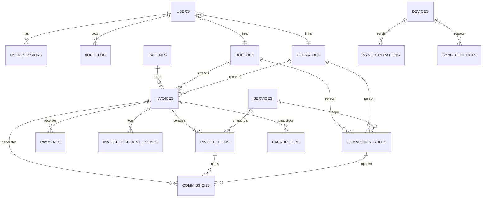

# طراحی پایگاه داده — White Rose Clinic (نسخهٔ Python)

> **فاز:** ۱ · **وضعیت:** پیش‌نویس برای تأیید مدیر · **DB سرور:** PostgreSQL 16 · **DB دسکتاپ:** SQLite/SQLCipher · **Developed by FoBa**
>
> این سند ساختار فیزیکی داده را تعریف می‌کند. **هیچ داده‌ای از نسخهٔ قبلی منتقل نمی‌شود**؛ ساختار و قواعد نسخهٔ مرجع مبنا هستند. نام جدول‌ها snake_case است؛ نام اکشن‌های API برای سازگاری با UI حفظ می‌شود (نگاشت در `MIGRATION_MAPPING.md`).

---

## ۱) اصول طراحی

1. **یک اسکیمای منطقی، دو پیاده‌سازی:** همان مدل SQLAlchemy 2.x روی PostgreSQL (سرور) و SQLite (دسکتاپ) با Alembic.
2. **UUIDv7 به‌عنوان PK** در کلاینت تولید می‌شود (امکان درج آفلاین)؛ در PG نوع `uuid`، در SQLite `BLOB(16)` با تابع تبدیل.
3. **مبالغ:** `NUMERIC(18,1)` تومان (یک رقم اعشار = ریال صحیح، مطابق `DEC-05`). در Python همیشه `Decimal`, هرگز `float`.
4. **درصدها:** `NUMERIC(5,2)` با `CHECK (0..100)`.
5. **زمان:** `TIMESTAMPTZ` (UTC) در PG؛ `TEXT` ISO-8601 UTC در SQLite. نمایش شمسی در لایهٔ نمایش.
6. **حذف نرم:** `deleted_at`, `deleted_by`, `is_deleted`؛ هیچ `DELETE` فیزیکی در عملیات کاربر.
7. **ردیابی:** `created_at/by`, `updated_at/by`, `row_version` (برای optimistic locking و همگام‌سازی).
8. **Audit جدا:** `audit_log` فقط-افزودنی با زنجیرهٔ هش.
9. **بدون دادهٔ نمونه:** مهاجرت‌ها فقط DDL؛ هیچ INSERT دادهٔ دمو در Alembic یا راه‌اندازی.
10. **صحت پول:** `CHECK` روی مقادیر غیرمنفی برای مبالغ عملیاتی.

---

## ۲) استاندارد ستون‌های مشترک (هر جدول دامنه)

| ستون | نوع PG | نوع SQLite | توضیح |
|---|---|---|---|
| `id` | `uuid` PK | `BLOB(16)` PK | UUIDv7 تولیدشده در کلاینت |
| `created_at` | `timestamptz NOT NULL` | `TEXT NOT NULL` | UTC |
| `created_by` | `uuid NULL` | `BLOB(16) NULL` | `users.id` یا سیستم |
| `updated_at` | `timestamptz NOT NULL` | `TEXT NOT NULL` | UTC |
| `updated_by` | `uuid NULL` | `BLOB(16) NULL` | آخرین تغییردهنده |
| `row_version` | `bigint NOT NULL DEFAULT 1` | `INTEGER NOT NULL DEFAULT 1` | +۱ در هر UPDATE (optimistic lock) |
| `is_deleted` | `boolean NOT NULL DEFAULT false` | `INTEGER NOT NULL DEFAULT 0` | حذف نرم |
| `deleted_at` | `timestamptz NULL` | `TEXT NULL` | |
| `deleted_by` | `uuid NULL` | `BLOB(16) NULL` | |
| `origin_node_id` | `uuid NULL` | `BLOB(16) NULL` | دستگاهی که رکورد را ساخت |
| `revision` | `bigserial` (ایندکس) | `INTEGER` | شمارندهٔ تغییر برای pull |

**قاعده:** `revision` فقط سمت سرور مقدار می‌گیرد (کلاینت آن را نادیده می‌گیرد). `row_version` برای تشخیص تعارض در هر دو طرف استفاده می‌شود.

---

## ۳) نمای ERD (منطقی)

---

## ۴) جداول شناسایی و امنیت

### ۴.۱ `users`

| ستون | نوع | قید |
|---|---|---|
| `id` | uuid | PK |
| `username` | `citext`/`varchar(64)` | **UNIQUE**، lowercase، ۳..۶۴ |
| `password_hash` | `varchar(255)` | NOT NULL (Argon2id encoded string) |
| `password_algo` | `varchar(32)` | `argon2id` \| `pbkdf2_sha256` (ارتقای تدریجی) |
| `password_params` | `jsonb` | `{}` (m, t, p یا iterations) — در SQLite `TEXT` |
| `must_change_password` | boolean | DEFAULT true برای کاربر جدید |
| `display_name` | `varchar(120)` | NOT NULL |
| `role` | `varchar(16)` | `CHECK (role IN ('admin','operator','doctor'))` |
| `linked_doctor_id` | uuid FK→`doctors.id` | NULL؛ برای نقش doctor الزامی (CHECK در سرویس) |
| `linked_operator_id` | uuid FK→`operators.id` | NULL |
| `is_active` | boolean | DEFAULT true |
| `failed_attempts` | smallint | DEFAULT 0 |
| `locked_until` | timestamptz | NULL |
| `last_login_at` | timestamptz | NULL |
| `last_password_change_at` | timestamptz | NULL |
| + ستون‌های مشترک | | |

**ایندکس‌ها:** `ux_users_username (username)` (شامل حذف‌شده‌ها تا نام کاربری آزاد نشود)، `ix_users_role_active (role, is_active)`, `ix_users_linked_doctor (linked_doctor_id)`.

### ۴.۲ `user_sessions`

| ستون | نوع | قید |
|---|---|---|
| `id` | uuid | PK |
| `user_id` | uuid | FK→`users.id` ON DELETE RESTRICT |
| `token_hash` | `char(64)` | **UNIQUE**، SHA-256 توکن |
| `device_info` | `varchar(255)` | NULL |
| `issued_at` / `expires_at` / `idle_expires_at` / `last_activity_at` | timestamptz | NOT NULL |
| `revoked_at` | timestamptz | NULL |
| `revoke_reason` | `varchar(64)` | NULL |
| + ستون‌های مشترک | | |

**ایندکس:** `ix_sessions_user_active (user_id, revoked_at, expires_at)`، `ux_sessions_token_hash`.

### ۴.۳ `audit_log` (فقط-افزودنی)

| ستون | نوع | قید |
|---|---|---|
| `id` | uuid | PK |
| `occurred_at` | timestamptz | NOT NULL، ایندکس |
| `actor_user_id` | uuid | NULL (رویداد سیستم) |
| `actor_username` | varchar(64) | snapshot متنی |
| `action` | varchar(64) | NOT NULL |
| `entity` | varchar(40) | NOT NULL |
| `entity_id` | varchar(64) | NULL |
| `before_json` / `after_json` | jsonb | ماسک‌شده |
| `result` | varchar(8) | `ok`/`fail` |
| `message` | text | NULL |
| `request_id` | uuid | NULL |
| `context` | varchar(255) | IP/device |
| `hash_prev` / `hash_self` | char(64) | زنجیرهٔ هش |

**قیدها:** `REVOKE UPDATE, DELETE` از `wrc_app` روی این جدول؛ ایندکس مرکب `(entity, entity_id, occurred_at DESC)` و `(action, occurred_at DESC)`.
**دورهٔ نگهداشت:** حداقل ۵ سال (TD-14).

### ۴.۴ `devices` (Desktop Agent)

`id` uuid PK · `node_code varchar(16)` **UNIQUE** (مثل `N01`، در شمارهٔ موقت فاکتور) · `label varchar(120)` · `enrolled_at timestamptz NOT NULL` · `enrolled_by uuid` (admin) · `device_token_hash char(64)` **UNIQUE** · `last_seen_at timestamptz` · `last_pull_revision bigint DEFAULT 0` · `is_active boolean` · `revoked_at timestamptz`.

---

## ۵) جداول پایه

### ۵.۱ `patients`

`id` PK · `full_name varchar(120) NOT NULL` · `mobile varchar(16) NULL` · `phone varchar(16) NULL` · `national_code char(10) NULL` · `birth_date date NULL` · `gender varchar(8) NULL` · `address text NULL` · `notes text NULL` · `status varchar(16) NOT NULL DEFAULT 'active' CHECK (status IN ('active','inactive'))` + ستون‌های مشترک.

**ایندکس:** `ix_patients_name (full_name)`، `ix_patients_mobile (mobile)`، `ix_patients_status (status)`.
**یکتایی:** موبایل یکتا **نیست** (خانواده ممکن است یک شماره داشته باشد)؛ بررسی تکراری به‌صورت هشدار در سرویس (نه قید DB).

### ۵.۲ `doctors` / `operators`

`id` PK · `full_name varchar(120) NOT NULL` · `mobile varchar(16) NULL` · `specialty varchar(120) NULL` (پزشک) / `role_title varchar(120) NULL` (اپراتور) · `notes text` · `is_active boolean DEFAULT true` · `status varchar(16)` + ستون‌های مشترک.
**ایندکس:** `ix_doctors_active (is_active)`، `ix_operators_active (is_active)`.

### ۵.۳ `services`

`id` PK · `name varchar(160) NOT NULL` · `category varchar(80) NULL` · `base_price_toman numeric(18,1) NOT NULL DEFAULT 0 CHECK (>= 0)` · `duration_min integer NOT NULL DEFAULT 0 CHECK (>= 0)` · `taxable boolean NOT NULL DEFAULT true` · `default_tax_rate numeric(5,2) NULL CHECK (0..100)` · `is_active boolean DEFAULT true` · `notes text` · `doctor_commission_type varchar(16) CHECK IN ('','percent','fixed_per_unit')` · `doctor_commission_value numeric(18,2) NOT NULL DEFAULT 0` · `operator_commission_type` / `operator_commission_value` (مشابه) + ستون‌های مشترک.

**قید:** `CHECK (doctor_commission_type <> 'percent' OR doctor_commission_value <= 100)` و مشابه برای اپراتور.
**ایندکس:** یکتایی منطقی `(lower(name), coalesce(category,''))` WHERE `is_deleted = false`.

---

## ۶) جداول تراکنشی

### ۶.۱ `invoices`

| ستون | نوع | قید/توضیح |
|---|---|---|
| `id` | uuid | PK |
| `invoice_no` | `varchar(32)` | **UNIQUE** جزئی (`WHERE invoice_no <> '' AND is_deleted = false`) |
| `invoice_no_provisional` | varchar(32) | NULL — شمارهٔ موقت آفلاین (`TMP-N01-000123`) |
| `invoice_date` | date | NOT NULL |
| `patient_id` | uuid | FK→`patients.id` RESTRICT |
| `doctor_id` | uuid | FK→`doctors.id` RESTRICT، NULL |
| `operator_id` | uuid | FK→`operators.id` RESTRICT، NULL |
| `status` | varchar(32) | CHECK در ۶ وضعیت (`draft`, `pending_discount_approval`, `issued`, `partially_paid`, `paid`, `void`) |
| `subtotal_toman` | numeric(18,1) | `>= 0` |
| `discount_requested_toman` | numeric(18,1) | `>= 0` |
| `discount_request_note` | text | |
| `discount_status` | varchar(16) | `none`/`requested`/`approved`/`rejected` |
| `discount_approved_toman` | numeric(18,1) | `>= 0` |
| `discount_approved_by` | uuid | FK→users |
| `discount_approved_at` | timestamptz | |
| `discount_rejected_reason` | text | |
| `discount_toman` | numeric(18,1) | مؤثر (پس از تأیید) |
| `tax_toman` | numeric(18,1) | `>= 0` |
| `total_toman` | numeric(18,1) | `>= 0` |
| `paid_toman` | numeric(18,1) | `>= 0` (مشتق از پرداخت‌ها) |
| `balance_toman` | numeric(18,1) | `>= 0` |
| `issued_at` / `issued_by` | timestamptz / uuid | |
| `amended_from_invoice_id` | uuid | FK→`invoices.id` (رزرو) |
| `void_reason` | text | برای `void` حداقل ۳ نویسه |
| `invoice_version` | integer | DEFAULT 1 (نسخه‌بندی اقلام) |
| `notes` | text | |
| + ستون‌های مشترک | | |

**قیدهای صحت:** `CHECK (total_toman >= 0)`, `CHECK (paid_toman >= 0)`, `CHECK (balance_toman >= 0)`, `CHECK (discount_toman <= subtotal_toman)`, `CHECK (status <> 'void' OR length(btrim(void_reason)) >= 3)`.
**ایندکس‌ها:** `ix_invoices_patient_date (patient_id, invoice_date DESC)`، `ix_invoices_doctor_date (doctor_id, invoice_date DESC)`، `ix_invoices_status_date (status, invoice_date DESC)`، `ux_invoices_no` جزئی، `ix_invoices_revision (revision)`.

### ۶.۲ `invoice_items`

`id` PK · `invoice_id uuid NOT NULL FK→invoices ON DELETE CASCADE` · `service_id uuid NULL FK→services` · `service_name_snapshot varchar(160) NOT NULL` · `description text` · `quantity numeric(12,2) NOT NULL CHECK (> 0)` · `unit_price_toman numeric(18,1) NOT NULL CHECK (>= 0)` · `line_gross_toman numeric(18,1) NOT NULL` · `line_discount_alloc_toman numeric(18,1) NOT NULL DEFAULT 0` · `line_net_after_discount_toman numeric(18,1) NOT NULL` · `effective_tax_rate numeric(5,2) NOT NULL DEFAULT 0` · `taxable boolean NOT NULL DEFAULT true` · `line_tax_toman numeric(18,1) NOT NULL DEFAULT 0` · `line_total_toman numeric(18,1) NOT NULL` · `commission_basis_toman numeric(18,1) NOT NULL` · `sort_order smallint NOT NULL DEFAULT 0` + ستون‌های مشترک.

**ایندکس:** `ix_items_invoice (invoice_id, sort_order)`، `ix_items_service (service_id)`.
**قاعده:** مجموع `line_discount_alloc_toman` باید برابر `invoices.discount_toman` باشد (اعتبارسنجی در سرویس + تست یکپارچگی).

### ۶.۳ `payments`

`id` PK · `invoice_id uuid NOT NULL FK→invoices RESTRICT` · `payment_date date NOT NULL` · `amount_toman numeric(18,1) NOT NULL CHECK (> 0)` · `method varchar(16) NOT NULL` (`cash`/`card`/`transfer`/`other`) · `reference_no varchar(64)` · `received_by uuid FK→users` · `status varchar(12) NOT NULL DEFAULT 'recorded'` (`recorded`/`void`) · `notes text` + ستون‌های مشترک.

**ایندکس:** `ix_payments_invoice_date (invoice_id, payment_date)`، `ix_payments_date_status (payment_date, status)`.

### ۶.۴ `invoice_discount_events`

`id` PK · `invoice_id uuid NOT NULL FK` · `event varchar(16)` (`requested`/`approved`/`rejected`) · `amount_toman numeric(18,1)` · `reason text` · `actor_user_id uuid` · `created_at` — بدون حذف نرم (رکورد تاریخی).
**ایندکس:** `ix_discount_events_invoice (invoice_id, created_at)`.

---

## ۷) جداول پورسانت

### ۷.۱ `commission_rules`

| ستون | نوع | قید |
|---|---|---|
| `id` | uuid | PK |
| `applies_to` | varchar(8) | CHECK IN ('doctor','operator') |
| `person_id` | uuid | FK منطقی به `doctors` یا `operators` (بسته به `applies_to`)، NULL |
| `service_id` | uuid | FK→`services`، NULL |
| `type` | varchar(16) | CHECK IN ('percent','fixed_per_unit') |
| `value` | numeric(18,2) | `>= 0`; برای percent `<= 100` |
| `calc_unit` | varchar(16) | DEFAULT 'line' / 'per_unit' |
| `basis_scope` | varchar(24) | DEFAULT 'invoice_item' |
| `priority` | smallint | DEFAULT 100 (کمتر = مقدم) |
| `is_active` | boolean | DEFAULT true |
| `effective_from` / `effective_to` | date | NULL |
| `notes` | text | |
| + ستون‌های مشترک | | |

**ایندکس:** `ix_rules_lookup (applies_to, is_active, priority)`، `ix_rules_person (person_id)`، `ix_rules_service (service_id)`.
**قاعده:** `person_id` و `service_id` هر دو NULL = قاعدهٔ عمومی (پیش‌فرض)؛ در نسخهٔ فعلی چنین قاعده‌ای عملاً همیشه با اولویت ۴ پوشش داده می‌شود، ولی مدل جدید آن را پشتیبانی می‌کند.

### ۷.۲ `commissions`

`id` PK · `invoice_id uuid NOT NULL FK→invoices RESTRICT` · `invoice_item_id uuid NOT NULL FK→invoice_items` · `invoice_version varchar(32)` · `person_type varchar(8)` (`doctor`/`operator`) · `person_id uuid NOT NULL` · `rule_id varchar(64)` (`uuid` یا `service:<id>` یا خالی = پیش‌فرض خدمت) · `commission_basis_toman numeric(18,1) NOT NULL` · `quantity numeric(12,2) NOT NULL` · `rate_or_amount_snapshot varchar(32) NOT NULL` · `commission_amount_toman numeric(18,1) NOT NULL CHECK (>= 0)` · `status varchar(12) NOT NULL DEFAULT 'calculated'` (`calculated`/`payable`/`paid`/`void`/`adjusted`) · `calculated_at/by` · `approved_payable_at/by` · `paid_at/by` · `payment_reference varchar(64)` · `voided_or_adjusted_at/by` · `adjustment_reason text` · `source_commission_id uuid` (برای تعدیل) + ستون‌های مشترک.

**ایندکس‌ها:** `ix_comm_invoice (invoice_id)`، `ix_comm_person_status (person_type, person_id, status)`، `ix_comm_status (status)`، `ux_comm_item_person` جزئی: یک رکورد فعال برای هر (قلم، ذی‌نفع) — `UNIQUE (invoice_item_id, person_type, person_id) WHERE is_deleted = false`.
**قید:** `CHECK (status <> 'paid' OR paid_at IS NOT NULL)`؛ `CHECK (status <> 'void' OR adjustment_reason <> '')`.

---

## ۸) جداول مالی و سیستمی

### ۸.۱ `expenses`

`id` PK · `date date NOT NULL` · `category varchar(80) NULL` · `amount_toman numeric(18,1) NOT NULL CHECK (> 0)` · `payee varchar(120) NULL` · `description text` · `status varchar(12) NOT NULL DEFAULT 'active'` (`active`/`void`) + ستون‌های مشترک.
**ایندکس:** `ix_expenses_date (date)`, `ix_expenses_status_date (status, date)`.

### ۸.۲ `other_income`

`id` PK · `date date NOT NULL` · `source_type varchar(24) NOT NULL DEFAULT 'misc'` · `source_id varchar(64) NULL` · `amount_toman numeric(18,1) NOT NULL CHECK (> 0)` · `description text` · `status varchar(12) NOT NULL DEFAULT 'active'` + ستون‌های مشترک.
**ایندکس:** `ix_income_date (date)`, `ix_income_status_date (status, date)`.
> نام شیت در نسخهٔ فعلی `Revenue` است؛ نام جدول جدید `other_income` (نام دقیق‌تر). نگاشت در `MIGRATION_MAPPING.md`.

### ۸.۳ `settings`

`key varchar(64) PK` · `value text NOT NULL` · `value_type varchar(12) NOT NULL` (`boolean`/`number`/`text`) · `description varchar(255)` · `updated_at timestamptz` · `updated_by uuid`.
**قاعده:** کاتالوگ کلیدها در کد (`SettingsCatalog`) است؛ کلید ناشناخته در DB = خطای `VALIDATION` (جلوگیری از تنظیم بی‌اثر). مقادیر همیشه به‌صورت رشتهٔ نرمال‌شده ذخیره می‌شوند (سازگار با نسخهٔ فعلی) اما با `CHECK` نوعی.

### ۸.۴ `sequences`

`key varchar(64) PK` · `next_value bigint NOT NULL DEFAULT 1` · `updated_at` · `updated_by`.
**استفاده:** تخصیص شمارهٔ فاکتور با `SELECT ... FOR UPDATE` روی ردیف `invoice_<year>` (معادل `LockService` فعلی، اما در سطح ردیف). **هرگز** در حالت آفلاین استفاده نمی‌شود.

### ۸.۵ `meta`

`key varchar(64) PK` · `value text` · `updated_at` · `updated_by`.
کلیدها: `schema_version` (همگام با Alembic head)، `app_version`، `installation_id`، `last_audit_hash`، `last_backup_at`.

### ۸.۶ `backup_jobs`

`id` PK · `kind varchar(16)` (`manual`/`scheduled`/`pre_restore`/`pre_wipe`) · `started_at`/`finished_at` · `status` (`running`/`ok`/`failed`) · `file_name varchar(255)` · `size_bytes bigint` · `checksum_sha256 char(64)` · `schema_version varchar(32)` · `row_counts jsonb` · `created_by uuid` · `error_message text`.

---

## ۹) جداول همگام‌سازی

### ۹.۱ `sync_operations` (سرور — dedupe)

| ستون | نوع | قید |
|---|---|---|
| `op_id` | uuid | **PK** (همان `op_id` کلاینت) |
| `device_id` | uuid | FK→`devices.id` |
| `device_seq` | bigint | NOT NULL؛ `UNIQUE (device_id, device_seq)` |
| `entity` | varchar(40) | NOT NULL |
| `op_type` | varchar(16) | `create`/`update`/`delete`/`command` |
| `entity_id` | uuid | NOT NULL |
| `base_row_version` | bigint | NULL |
| `payload_hash` | char(64) | برای تشخیص دست‌کاری/تکرار متفاوت |
| `status` | varchar(16) | `applied`/`rejected`/`conflict`/`duplicate` |
| `result_code` | varchar(32) | کد خطای دامنه در صورت رد |
| `result_json` | jsonb | نتیجهٔ اعمال (شامل شمارهٔ رسمی و `row_version`) |
| `received_at` / `processed_at` | timestamptz | |
| `server_revision` | bigint | شمارندهٔ اختصاص‌یافته در `change_feed` |

**قاعده:** درج `op_id` و اعمال تغییر در **یک تراکنش**؛ در تکرار، همان `result_json` برگردانده می‌شود. `payload_hash` متفاوت با همان `op_id` = `409 CONFLICT` (نشانهٔ نقض قرارداد/دست‌کاری).

### ۹.۲ `change_feed` (سرور — pull)

`revision bigint PRIMARY KEY (generated always as identity)` · `entity varchar(40) NOT NULL` · `entity_id uuid NOT NULL` · `op varchar(8)` (`upsert`/`delete`) · `row_version bigint NOT NULL` · `changed_at timestamptz NOT NULL` · `changed_by uuid NULL` · `origin_device_id uuid NULL`.

**ایندکس:** `ix_feed_entity_rev (entity, revision)`؛ نگهداشت: حذف رکوردهای قدیمی‌تر از آخرین snapshot دوره‌ای (compaction) با حفظ watermark.

### ۹.۳ `sync_conflicts`

`id` PK · `device_id uuid` · `op_id uuid` · `entity varchar(40)` · `entity_id uuid` · `kind varchar(24)` (`state_conflict`/`version_conflict`/`validation`/`business_rule`) · `client_payload jsonb` · `server_snapshot jsonb` · `status varchar(16)` (`open`/`resolved_client`/`resolved_server`/`discarded`) · `resolution_note text` · `resolved_by uuid` · `resolved_at timestamptz` · `created_at`.

**ایندکس:** `ix_conflicts_open (status, created_at DESC)`.

### ۹.۴ `sync_outbox` (فقط کلاینت — SQLite)

`op_seq INTEGER PRIMARY KEY AUTOINCREMENT` (ترتیب محلی) · `op_id uuid UNIQUE` · `device_id uuid` · `entity` · `entity_id` · `op_type` · `base_row_version` · `payload TEXT (JSON)` · `depends_on uuid NULL` · `occurred_at TEXT` · `status` (`pending`/`sending`/`acked`/`rejected`/`conflict`) · `attempts INTEGER DEFAULT 0` · `next_retry_at TEXT` · `last_error TEXT` · `server_result TEXT`.

**ایندکس:** `ix_outbox_pending (status, op_seq)`، `ix_outbox_retry (status, next_retry_at)`.

---

## ۱۰) مرزهای تراکنش (Transaction Boundaries)

| عملیات | قفل | محتوای تراکنش |
|---|---|---|
| `invoices.saveDraft` (ایجاد) | — | درج سربرگ + اقلام + Audit (درج idempotent با `id` کلاینت) |
| `invoices.saveDraft` (ویرایش) | `SELECT … FOR UPDATE` روی فاکتور | بررسی وضعیت + `row_version` + جایگزینی اقلام (نسخهٔ جدید) + Audit |
| `invoices.requestDiscount` | فاکتور FOR UPDATE | ثبت درخواست + رویداد + تغییر وضعیت + Audit |
| `invoices.approveDiscount` | فاکتور FOR UPDATE | اعمال مبلغ، توزیع تخفیف روی اقلام، بازمحاسبهٔ مالیات/جمع، رویداد، Audit |
| `invoices.issue` | فاکتور + ردیف `sequences` FOR UPDATE | شماره‌گذاری، وضعیت، محاسبهٔ پورسانت (درج)، Audit |
| `payments.add` | فاکتور FOR UPDATE | درج پرداخت + بازمحاسبهٔ paid/balance/status + Audit |
| `invoices.void` | فاکتور FOR UPDATE | ابطال + پورسانت void/adjusted + Audit |
| `commissions.approvePayable` / `markPaid` | هر رکورد FOR UPDATE | بررسی وضعیت مبدأ + گذار + Audit |
| `settings.setMany` | — (upsert اتمی) | اعتبارسنجی همه → نوشتن همه یا هیچ + Audit |
| `system.wipeData` | advisory lock سراسری | soft-delete دسته‌ای + خاتمهٔ نشست‌ها + Audit |
| `sync.push` (هر پاکت) | ردیف هدف (در صورت وجود) | dedupe + اعمال + ثبت `change_feed` + Audit |

**قواعد عمومی:**
- هر درخواست = یک `Session` با `BEGIN … COMMIT`؛ خطای دامنه = `ROLLBACK`.
- عملیات شبکه/فایل (پشتیبان‌گیری، PDF) **بیرون** از تراکنش DB.
- `row_version` در هر UPDATE +۱ می‌شود (در سطح ORM یا trigger).

---

## ۱۱) حذف نرم، نگهداشت و Purge

- حذف نرم در همهٔ جداول دامنه؛ ردیف در کوئری‌های عادی نادیده گرفته می‌شود (`WHERE is_deleted = false` در ریپازیتوری، نه در سرویس‌ها).
- یکتایی‌ها باید **جزئی** باشند (`WHERE is_deleted = false`) تا رکورد حذف‌شده مانع ایجاد مجدد نشود — به‌جز `users.username` که ماندگار یکتاست (جلوگیری از جعل هویت).
- Purge فیزیکی (TD-15) فقط با اسکریپت مدیر و پس از تأیید: حذف رکوردهای نرم‌حذف‌شدهٔ قدیمی‌تر از N سال، به‌شرط نبود وابستگی مالی. Audit هرگز Purge نمی‌شود.
- پاک‌سازی «حذف کلی اطلاعات» = soft-delete (رفتار مرجع)؛ بازیابی با Restore.

---

## ۱۲) تفاوت‌های پیاده‌سازی SQLite (Desktop)

| موضوع | PostgreSQL | SQLite | راهکار |
|---|---|---|---|
| UUID | `uuid` | `BLOB(16)` | `TypeDecorator` مشترک (`uuid7` ↔ bytes) |
| Boolean | `boolean` | `INTEGER 0/1` | SQLAlchemy `Boolean` با `create_constraint` |
| JSON | `jsonb` | `TEXT` | `TypeDecorator` (`json_serializer`) |
| زمان | `timestamptz` | `TEXT` ISO-8601 | `TypeDecorator` (همیشه UTC) |
| Decimal | `numeric(18,1)` | `NUMERIC` | SQLAlchemy `Numeric(18,1, asdecimal=True)` |
| `citext` | — | — | در SQLite: `COLLATE NOCASE` + نرمال‌سازی در سرویس |
| قفل ردیف (`FOR UPDATE`) | ✅ | ❌ | در SQLite: تراکنش `BEGIN IMMEDIATE` + قفل سراسری نوشتن (تک‌کاربره در سطح DB) |
| ایندکس جزئی | ✅ | ✅ | پشتیبانی می‌شود |
| `generated identity` | `bigserial`/identity | `INTEGER PK AUTOINCREMENT` | Alembic با `batch_alter_table` |
| `ON DELETE CASCADE` | ✅ | ✅ (با `PRAGMA foreign_keys=ON`) | فعال‌سازی در `connect` event |

**الزامات SQLite:** `PRAGMA journal_mode=WAL`، `PRAGMA foreign_keys=ON`، `PRAGMA synchronous=FULL` (یا `NORMAL` با WAL)، `busy_timeout=5000`، `key` SQLCipher از DPAPI.

**قیدهای CHECK در SQLite:** پشتیبانی می‌شوند؛ ولی `ALTER TABLE` محدود است → Alembic `batch_alter_table` اجباری.

---

## ۱۳) مهاجرت اسکیما و نسخه‌بندی

- Alembic با **یک** مجموعهٔ migration برای هر دو موتور، با شاخه‌بندی شرطی بر اساس `dialect.name` در موارد ناسازگار.
- نام‌گذاری قطعی: `YYYYMMDD_HHMM_<slug>`؛ یک `head` واحد در هر انتشار.
- `meta.schema_version` در پایان هر migration به‌روزرسانی می‌شود (هم‌تراز با `alembic_version`).
- بازگشت (`downgrade`) فقط برای یک نسخهٔ عقب و فقط در محیط توسعه.
- هیچ migration دادهٔ نمونه/Seed ندارد. تنها دادهٔ سیستمی مجاز: `settings` پیش‌فرض‌ها و `meta.schema_version` (بدون دادهٔ عملیاتی).
- کتابخانهٔ پشتیبان شامل `schema_version` است؛ Restore در نسخهٔ ناهمخوان رد می‌شود (`VALIDATION`) یا با تأیید صریح به migration زنجیره‌ای می‌رود.

---

## ۱۴) کارایی و یکپارچگی

- **صفحه‌بندی اجباری** برای `invoices.*`، `audit_log`، `commissions` (پیش‌فرض ۵۰، حداکثر ۲۰۰) — رفع `M-04`.
- **کوئری فیلتر سمت سرور** (`status`, `from`, `to`, `q`, `patient_id`, `doctor_id`) با ایندکس‌های مرکب تعریف‌شده.
- **جلوگیری از N+1:** بارگذاری اقلام/پرداخت‌ها با `selectinload` برای صفحهٔ جزئیات.
- **ویوهای گزارش:** فاز بعد؛ در فاز ۱ کوئری‌های تجمیعی با `GROUP BY` و ایندکس تاریخ.
- **بررسی‌های یکپارچگی دوره‌ای (Job):**
  1. `sum(payments.amount)` == `invoices.paid_toman` برای فاکتورهای غیرباطل.
  2. `sum(invoice_items.line_discount_alloc)` == `invoices.discount_toman`.
  3. `subtotal + tax − discount == total` (با گرد کردن ریال).
  4. پورسانت‌های `paid` با `paid_at` پرشده.
  5. زنجیرهٔ هش `audit_log` بدون شکست.
- **محدودیت‌های حجم:** فایل SQLite دسکتاپ با checkpoint منظم WAL؛ پشتیبان قبل از compaction.
- **پارتیشن‌بندی آینده:** `audit_log` و `change_feed` بر اساس ماه (فاز بعد، در صورت رشد).

---

## ۱۵) نگاشت جدول‌های نسخهٔ فعلی (خلاصه)

| شیت فعلی | جدول جدید | یادداشت |
|---|---|---|
| `Meta` | `meta` | نسخه + شناسه نصب |
| `Settings` | `settings` | key/value + نوع + راهنما |
| `Users` | `users` | PBKDF2 → Argon2id (ارتقای تدریجی) |
| `Customers` | `patients` | حفظ `customers.*` در API |
| `Doctors` | `doctors` | — |
| `Operators` | `operators` | — |
| `Services` | `services` | چهار ستون پورسانت حفظ می‌شود |
| `Invoices` | `invoices` | + `invoice_no_provisional`, `invoice_version` |
| `InvoiceItems` | `invoice_items` | + `effective_tax_rate` |
| `Payments` | `payments` | — |
| `Revenue` | `other_income` | — |
| `Expenses` | `expenses` | — |
| `CommissionRules` | `commission_rules` | — |
| `Commissions` | `commissions` | + `source_commission_id` |
| `AuditLog` | `audit_log` | + زنجیرهٔ هش |
| `Sequences` | `sequences` | قفل ردیف به‌جای LockService |
| `Sessions` | `user_sessions` | منبع اصلی، نه Cache |
| — | `invoice_discount_events`, `devices`, `sync_operations`, `change_feed`, `sync_conflicts`, `backup_jobs` | جداول جدید |

نگاشت ستون‌به‌ستون و قواعد تبدیل در `MIGRATION_MAPPING.md`.

---

## ۱۶) جداول اصلاح فاکتور (TDR-012 — قطعی)

### ۱۶.۱ `invoice_amendments`

| ستون | نوع | قید |
|---|---|---|
| `id` | uuid | PK (UUIDv7) |
| `invoice_id` | uuid | FK→`invoices.id` RESTRICT، NOT NULL |
| `amendment_no` | integer | NOT NULL؛ `UNIQUE (invoice_id, amendment_no)` |
| `status` | varchar(12) | `draft`/`issued`/`void` |
| `reason` | text | NOT NULL؛ `CHECK (length(btrim(reason)) >= 3)` |
| `before_snapshot_json` | jsonb | totals/items در زمان درخواست |
| `after_snapshot_json` | jsonb | totals/items پس از اصلاح |
| `delta_subtotal_toman` / `delta_discount_toman` / `delta_tax_toman` / `delta_total_toman` | numeric(18,1) | دلتای مالی (می‌تواند منفی باشد) |
| `requested_by` / `requested_at` | uuid / timestamptz | |
| `issued_by` / `issued_at` | uuid / timestamptz | |
| `void_reason` / `voided_by` / `voided_at` | text / uuid / timestamptz | برای `void` الزامی |
| `notes` | text | |
| + ستون‌های مشترک (Audit/Sync) | | |

**قیدها:** `CHECK (status <> 'issued' OR issued_at IS NOT NULL)`؛ `CHECK (status <> 'void' OR length(btrim(void_reason)) >= 3)`.
**ایندکس‌ها:** `ix_amendments_invoice (invoice_id, amendment_no DESC)`، `ix_amendments_status (status, created_at DESC)`، `ix_amendments_revision (revision)`.

### ۱۶.۲ `invoice_amendment_items`

| ستون | نوع | قید |
|---|---|---|
| `id` | uuid | PK |
| `amendment_id` | uuid | FK→`invoice_amendments.id` ON DELETE CASCADE |
| `invoice_item_id` | uuid | FK→`invoice_items.id`، NULL (برای ردیف جدید) |
| `action` | varchar(12) | `add`/`update`/`remove` |
| `quantity_before` / `quantity_after` | numeric(12,2) | NULL برای add/remove |
| `unit_price_before_toman` / `unit_price_after_toman` | numeric(18,1) | همان |
| `taxable_after` / `effective_tax_rate_after` | boolean / numeric(5,2) | |
| `line_gross_after_toman`, `line_discount_alloc_after_toman`, `line_tax_after_toman`, `line_total_after_toman`, `commission_basis_after_toman` | numeric(18,1) | محاسبه‌شده با همان موتور مالی |
| `delta_total_toman` | numeric(18,1) | تفاوت با قبل |
| `description_snapshot` | varchar(160) | نام خدمت/شرح |
| `sort_order` | smallint | |
| + ستون‌های مشترک | | |

**ایندکس:** `ix_amendment_items_amendment (amendment_id, sort_order)`، `ix_amendment_items_invoice_item (invoice_item_id)`.
**قاعده:** برای هر اصلاح، مجموع `delta_total_toman` اقلام باید برابر `delta_total_toman` سربرگ باشد (اعتبارسنجی در سرویس + تست).

### ۱۶.۳ تغییرات لازم در `invoices`

| ستون جدید | نوع | توضیح |
|---|---|---|
| `amendment_count` | integer | DEFAULT 0؛ تعداد اصلاح‌های صادرشده |
| `last_amendment_id` | uuid | FK→`invoice_amendments.id` (آخرین اصلاح معتبر) |
| `last_amended_at` | timestamptz | |
| `version` | integer | DEFAULT 1؛ با هر اصلاح صادرشده +۱ (نسخهٔ اقلام) |

**قاعدهٔ عدم بازنویسی:** `invoice_no`, `invoice_date`, `issued_at` و اسنپ‌شات اقلام هرگز تغییر نمی‌کنند؛ اصلاح اقلام به‌صورت ردیف جدید با `invoice_version` بالاتر و نرم‌حذف نسخهٔ قبلی ثبت می‌شود.

---

## ۱۷) جداول اعتبار بیمار (TDR-016 — قطعی)

### ۱۷.۱ `patient_credit_accounts`

| ستون | نوع | قید |
|---|---|---|
| `id` | uuid | PK |
| `patient_id` | uuid | FK→`patients.id` RESTRICT؛ **UNIQUE** |
| `balance_toman` | numeric(18,1) | NOT NULL DEFAULT 0؛ `CHECK (balance_toman >= 0)` |
| `last_transaction_at` | timestamptz | NULL |
| + ستون‌های مشترک | | |

**نکته:** `balance_toman` فقط cache است؛ منبع حقیقت، جمع `patient_credit_transactions.signed_amount_toman` است.

### ۱۷.۲ `patient_credit_transactions` (دفتر فقط-افزودنی)

| ستون | نوع | قید |
|---|---|---|
| `id` | uuid | PK |
| `patient_id` | uuid | FK→`patients.id` RESTRICT |
| `account_id` | uuid | FK→`patient_credit_accounts.id` |
| `txn_type` | varchar(16) | `overpayment`/`credit_applied`/`refund`/`adjustment`/`reversal` |
| `direction` | varchar(3) | `in`/`out` |
| `amount_toman` | numeric(18,1) | `> 0` (قدر مطلق) |
| `signed_amount_toman` | numeric(18,1) | NOT NULL؛ `in` مثبت، `out` منفی |
| `balance_after_toman` | numeric(18,1) | موجودی پس از گردش (snapshot) |
| `invoice_id` | uuid | FK→`invoices.id`، NULL |
| `payment_id` | uuid | FK→`payments.id`، NULL |
| `related_transaction_id` | uuid | FK→خود جدول (برای `reversal`) |
| `idempotency_key` | varchar(96) | **UNIQUE** (مثلاً `pay:<payment_id>`) |
| `reason` | text | برای `adjustment`/`reversal` الزامی |
| `created_at` / `created_by` | timestamptz / uuid | |

**قیدها:** `CHECK ((direction = 'in' AND signed_amount_toman = amount_toman) OR (direction = 'out' AND signed_amount_toman = -amount_toman))`.
**ایندکس‌ها:** `ix_credit_txn_patient (patient_id, created_at DESC)`، `ix_credit_txn_invoice (invoice_id)`، `ux_credit_txn_idem (idempotency_key)`.
**ممنوعیت:** UPDATE/DELETE همهٔ گردش‌ها (فقط `reversal` با رکورد جدید).

### ۱۷.۳ تغییرات لازم در `payments`

| ستون جدید | نوع | توضیح |
|---|---|---|
| `credit_transaction_id` | uuid | FK→`patient_credit_transactions.id`؛ برای `method='credit'` |
| `overpayment_credit_id` | uuid | FK→`patient_credit_transactions.id`؛ برای مبلغ اضافه |

**قاعدهٔ اتمی:** پرداخت نقدی/کارتی که از مانده بیشتر است → در یک تراکنش: `payments(amount=مانده)` + `patient_credit_transactions(overpayment, in, مازاد, idempotency_key='pay:<payment_id>')` + به‌روزرسانی `patients_credit_accounts.balance`.
**قاعدهٔ استفادهٔ اعتبار:** `payments(method='credit', amount=X)` + `patient_credit_transactions(credit_applied, out, X, idempotency_key='credituse:<payment_id>')`.

---

## ۱۸) جداول RBAC و تغییرات فاز ۳ (نسخهٔ ۰.۶.۰ — مهاجرت `a4576410fc23`)

### ۱۸.۱ `roles`

| ستون | نوع | قید |
|---|---|---|
| `id` | uuid | PK (UUIDv7) |
| `code` | varchar(64) | **UNIQUE**، `^[a-z][a-z0-9_]{1,63}$` |
| `name` | varchar(120) | NOT NULL |
| `description` | text | NULL |
| `is_system` | boolean | DEFAULT false؛ نقش `owner` محافظت‌شده است |
| `is_active` | boolean | DEFAULT true |
| `legacy_role` | varchar(16) | `admin`/`operator`/`doctor` — فقط projection منوی فعلی |
| + ستون‌های مشترک | | Audit/SoftDelete/Sync |

**ایندکس:** `uq_roles_code`, `ix_roles_active`.

### ۱۸.۲ `role_permissions`

`role_id uuid FK→roles ON DELETE CASCADE` + `permission_code varchar(64)` به‌صورت **PK مرکب**؛ `assigned_by uuid`, `assigned_at timestamptz`.
کد مجوز باید در کاتالوگ کد (`PERMISSION_CODES`) باشد؛ در غیر این صورت `VALIDATION`. ایندکس `ix_role_permissions_code`.

### ۱۸.۳ `user_roles`

`user_id uuid FK→users ON DELETE CASCADE` + `role_id uuid FK→roles ON DELETE CASCADE` (**PK مرکب**)، `assigned_by`, `assigned_at`.
چند نقش برای یک کاربر مجاز است؛ مجوز مؤثر = اجتماع مجوزهای نقش‌های `is_active=true`.

### ۱۸.۴ تغییرات جدول‌های موجود

| جدول | ستون جدید | توضیح |
|---|---|---|
| `user_sessions` | `ip_address varchar(45)`, `user_agent varchar(255)` | ردیابی نشست/نمایش به کاربر |
| `audit_log` | `ip_address varchar(45)`, `user_agent varchar(255)` | الزامات فاز ۳ |
| `users` | بدون تغییر ساختاری | ستون `role` فقط projection نمایشی است؛ منبع مجوز `user_roles` است |

### ۱۸.۵ قواعد یکپارچگی
- `users.role` هم‌زمان با تخصیص/حذف نقش‌ها بازمحاسبه می‌شود (admin > operator > doctor) تا منوی فعلی سازگار بماند؛ **مبنای مجوز نیست**.
- حذف فیزیکی `users` در API وجود ندارد (فقط غیرفعال‌سازی)، بنابراین FKها با `RESTRICT/CASCADE` امن هستند.
- نقش سیستمی: ویرایش/غیرفعال‌سازی/تغییر مجوز ممنوع (سرویس + تست).
- Audit همچنان فقط-افزودنی است؛ `roles`/`user_roles` تغییرات خود را در Audit ثبت می‌کنند.
- مهاجرت فقط DDL است؛ هیچ نقش/کاربر/مجوز تخصیص‌یافته‌ای در migration ساخته نمی‌شود (Bootstrap امن جداگانه).

