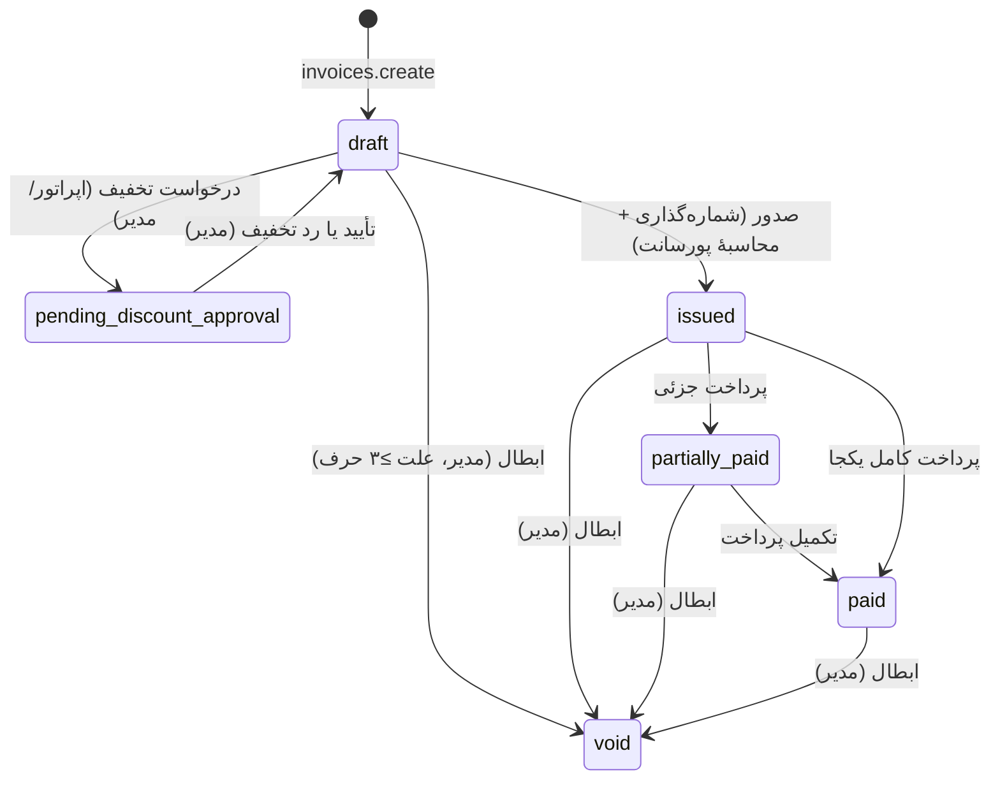

# مدل دامنه — White Rose Clinic (نسخهٔ Python)

> **فاز:** ۱ · **وضعیت:** پیش‌نویس برای تأیید مدیر · **مرجع:** کد `Server_00..15.gs` v0.4.3 + `docs/permissions.md` + ممیزی ۰.۴.۳ · **Developed by FoBa**
>
> این سند ۱۸ ماژول خواسته‌شده را با مدل داده، ارتباطات، قواعد تجاری و مجوزها تعریف می‌کند. هر قاعده بر پایهٔ رفتار واقعی کد نسخهٔ مرجع است و موارد اصلاحی از ممیزی با نشان `[AUDIT]` مشخص شده‌اند.

---

## ۰) قواعد عمومی دامنه

| موضوع | قاعدهٔ قطعی |
|---|---|
| واحد پول | ورودی/نمایش **تومان**؛ هر محاسبه مالی به **نزدیک‌ترین ریال صحیح** گرد می‌شود (`DEC-05`) → ذخیرهٔ تومان با حداکثر **یک رقم اعشار** |
| تاریخ | ذخیرهٔ میلادی `DATE`/ISO؛ نمایش **شمسی**؛ منطقهٔ زمانی `Asia/Tehran` (`DEC-06`) |
| هفته/ماه گزارش | هفته **شنبه‌محور**؛ باکت ماهانه بر مبنای **ماه شمسی** (`DEC-07`) |
| شناسه | UUID نسخهٔ ۷، تولیدشده در کلاینت (امکان ایجاد آفلاین) |
| حذف | **نرم** (`deleted_at`, `deleted_by`, `is_deleted`)؛ بدون حذف فیزیکی؛ حذف قطعی فقط با سیاست جداگانه |
| ردیابی | `created_at/by`, `updated_at/by` در همهٔ جداول اصلی + `row_version` |
| مجوز | فقط سمت سرور؛ UI مرجع مجوز نیست؛ فیلتر داده (مثلاً «فاکتورهای پزشک») در **کوئری** اعمال می‌شود |
| رُند کردن | `Decimal` با `ROUND_HALF_UP`؛ ممنوعیت `float` در مسیر مالی |
| مبالغ صفر/منفی | مبلغ منفی مجاز نیست؛ مانده در صفر کلمپ می‌شود |

### نقش‌ها
سه نقش ثابت (بدون نقش جدید در فاز ۱): `admin` (مدیر)، `operator` (اپراتور)، `doctor` (پزشک). کاربر می‌تواند به رکورد `doctors` یا `operators` لینک شود (`linked_doctor_id` / `linked_operator_id`) تا فیلتر «دادهٔ خودم» ممکن شود.

---

## ۱) احراز هویت (Authentication)

**موجودیت‌ها:** `user_sessions`, `users` (فیلدهای رمز), `login_attempts` (اختیاری، مشتق از `users.failed_attempts` + audit).

**قواعد:**
- ورود با **نام کاربری + رمز**؛ نام کاربری نرمال‌شده (lowercase، trim) و یکتا.
- رمز حداقل ۸ نویسه؛ هش با **Argon2id** (پیشنهاد نسخهٔ جدید؛ نسخهٔ فعلی PBKDF2-HMAC-SHA256 + pepper) — جزئیات در `SECURITY_DESIGN.md`.
- قفل ورود: ۵ تلاش ناموفق → قفل ۱۵ دقیقه؛ ریست با ورود موفق یا بازنشانی مدیر.
- نشست: توکن تصادفی ۲۵۶ بیتی، **فقط هش آن** ذخیره می‌شود؛ TTL مطلق ۸ ساعت، بیکاری ۶۰ دقیقه، حداکثر ۳ نشست هم‌زمان (چهارمی قدیمی‌ترین را باطل می‌کند).
- ابطال نشست‌ها: خروج، تغییر رمز، غیرفعال‌سازی کاربر، بازنشانی رمز، ابطال دستی مدیر.
- Bootstrap یک‌بارهٔ مدیر اول فقط وقتی هیچ مدیر فعالی وجود ندارد؛ الزام تغییر رمز در اولین ورود.
- `[AUDIT H-03]` نشست در **جدول** ذخیره می‌شود (نه فقط Cache) و کش صرفاً لایهٔ سرعت است.

**مجوز:** `auth.login` عمومی (نرخ‌محدود)، `auth.me`/`auth.logout`/`auth.changePassword` برای کاربر احراز‌شده، `setup.bootstrapAdmin` عمومی فقط یک‌بار.

---

## ۲) کاربران و نقش‌ها (Users and Roles)

**موجودیت:** `users`

| فیلد | نوع/قاعده |
|---|---|
| `username` | یکتا، lowercase، ۳..۶۴ نویسه |
| `password_hash/salt/algo/params` | Argon2id؛ پارامترها ذخیره می‌شوند تا ارتقا تدریجی ممکن باشد |
| `display_name` | پیش‌فرض = username |
| `role` | `admin` \| `operator` \| `doctor` |
| `linked_doctor_id` / `linked_operator_id` | برای نقش پزشک الزامی (وگرنه دسترسی «خودم» ندارد) |
| `is_active`, `must_change_password` | boolean |
| `failed_attempts`, `locked_until`, `last_login_at`, `last_password_change_at` | وضعیت امنیتی |

**قواعد:**
- فقط `admin` می‌تواند کاربر بسازد/ویرایش/رمز بازنشانی کند.
- تغییر نقش یا غیرفعال‌سازی → ابطال فوری همهٔ نشست‌های آن کاربر.
- حذف نرم کاربر؛ نام کاربری حتی پس از حذف قابل استفادهٔ مجدد نیست (یکتایی ماندگار).
- حذف/غیرفعال‌سازی آخرین مدیر فعال ممنوع است (قاعدهٔ جدید پیشنهادی؛ نسخهٔ فعلی ندارد).

**مجوز:** `users.manage` = admin.

---

## ۳) مشتریان / بیماران (Patients)

**موجودیت:** `patients` (نام اکشن‌های API برای سازگاری `customers.*` می‌ماند — `MIGRATION_MAPPING.md`).

| فیلد | قاعده |
|---|---|
| `full_name` | الزامی، ۲..۱۲۰ نویسه، trim |
| `mobile` | اختیاری ولی اگر داده شود: ارقام فارسی/عربی→لاتین، حذف غیررقم، `09xxxxxxxxx` یا `+989xxxxxxxxx` |
| `phone` | اختیاری: `0` + ۸..۱۰ رقم |
| `national_code` | اختیاری، ۱۰ رقم با اعتبارسنجی رقم کنترلی (اصلاح پیشنهادی) |
| `birth_date`, `gender`, `address`, `notes` | اختیاری؛ تاریخ `DATE` |
| `status` | `active` \| `inactive` |

**قواعد:** ایجاد از داخل فرم فاکتور مجاز است (`REQ-INV-02`/`03`) و باید idempotent باشد (جلوگیری از ثبت تکراری با دوبار کلیک). حذف فقط مدیر و نرم. پزشک فقط مشتریانی را می‌بیند که با او فاکتور دارند.

**مجوز:** مشاهده/ایجاد/ویرایش: admin+operator · حذف: admin · پزشک: `patients.read.limited`.

---

## ۴) پزشکان (Doctors)

**موجودیت:** `doctors` — `full_name` (الزامی)، `specialty`, `mobile`, `notes`, `is_active`.
**قواعد:** تعریف/ویرایش/حذف فقط مدیر. حذف پزشکی که فاکتور دارد مجاز نیست (پیشنهاد: غیرفعال‌سازی به‌جای حذف؛ در نسخهٔ فعلی فقط soft-delete). پورسانت پزشک در دو سطح تعریف می‌شود: پیش‌فرض خدمت و قاعدهٔ اختصاصی (بخش ۱۱).
**مجوز:** `doctors.read` = admin+operator · `doctors.manage` = admin.

---

## ۵) اپراتورها (Operators)

**موجودیت:** `operators` — `full_name` (الزامی)، `mobile`, `role_title`, `notes`, `is_active`.
**قواعد:** تعریف/ویرایش/حذف فقط مدیر. اپراتورِ ثبت‌کنندهٔ فاکتور روی فاکتور ذخیره می‌شود (`operator_id`) و مبنای پورسانت اپراتور است. اگر فاکتور بدون انتخاب اپراتور ثبت شود، اپراتورِ کاربر جاری (در صورت وجود) درج می‌شود.
**مجوز:** `operators.read` = admin+operator · `operators.manage` = admin.

---

## ۶) خدمات و تعرفه‌ها (Services and Pricing)

**موجودیت:** `services`

| فیلد | قاعده |
|---|---|
| `name` | الزامی، یکتا در ترکیب `name + category` (پیشنهاد) |
| `category` | اختیاری |
| `base_price_toman` | ≥ 0، پیش‌فرض قیمت قلم فاکتور |
| `duration_min` | ≥ 0 |
| `taxable` | boolean (پیش‌فرض از تنظیمات `invoice_default_taxable`) |
| `default_tax_rate` | ۰..۱۰۰ (اختیاری؛ در نبود آن نرخ تنظیمات استفاده می‌شود) |
| `is_active` | غیرفعال‌سازی بدون حذف |
| `doctor_commission_type/value` | `''` \| `percent` (۰..۱۰۰) \| `fixed_per_unit` |
| `operator_commission_type/value` | مشابه بالا |

**قواعد:** قیمت و پورسانت در **زمان صدور** در قلم فاکتور اسنپ‌شات می‌شود؛ تغییر تعرفه روی فاکتورهای گذشته اثر ندارد. تغییر قیمت/مالیات فقط مدیر.
**مجوز:** `services.read` = admin+operator+doctor (پزشک برای نمایش اقلام) · `services.manage` = admin.

---

## ۷) فاکتورها (Invoices)

**موجودیت:** `invoices` با فیلدهای محاسباتی و چرخهٔ تخفیف.

### ماشین وضعیت


### قواعد تجاری
1. **ثبت/ویرایش پیش‌نویس:** فقط در وضعیت `draft` یا `pending_discount_approval`؛ حداقل یک قلم الزامی؛ اقلام قبلی نرم‌حذف و بازنویسی می‌شوند (رفتار نسخهٔ فعلی) — در نسخهٔ جدید به‌جای بازنویسی، **نسخه‌بندی اقلام** با `invoice_version` ترجیح داده می‌شود (TDR-010).
2. **تخفیف:** مبلغ درخواستی ثبت می‌شود (وضعیت `requested`)، تا تأیید مدیر اعمال نمی‌شود؛ مدیر می‌تواند مبلغ تأییدشده را کمتر/برابر درخواست تعیین کند؛ رد تخفیف علت دارد. هر رویداد تخفیف در `invoice_discount_events` ثبت می‌شود (تاریخچهٔ کامل).
3. **صدور:** شمارهٔ فاکتور `PREFIX-YYYY-NNNNNN` (پیشوند ۱..۸ نویسه، سال میلادی تاریخ فاکتور، شمارندهٔ ۶ رقمی) **فقط سمت سرور**؛ در صدور، پورسانت‌ها محاسبه می‌شوند؛ فاکتور صادرشده اسنپ‌شات غیرقابل‌ویرایش مستقیم است.
4. **ابطال:** فقط مدیر، علت اجباری ≥۳ حرف، پورسانت‌های `calculated/payable` → `void` و `paid` → `adjusted`؛ پرداخت‌های فاکتور باطل از درآمد حذف می‌شوند `[AUDIT H-01]`.
5. **مانده:** `balance = max(0, total - paid)`؛ وضعیت پرداخت از مجموع پرداخت‌های معتبر محاسبه می‌شود (نه فقط شمارندهٔ محلی).
6. **تغییر تنظیمات** روی فاکتورهای گذشته اثر ندارد؛ مالیات و قیمت در قلم اسنپ‌شات می‌شود.
7. **اصلاح فاکتور صادرشده** (Amendment): فیلد `amended_from_invoice_id` رزرو شده است؛ در فاز ۱ فقط طراحی، بدون پیاده‌سازی — نیازمند تأیید مدیر (TD-11).

**مجوز:** مشاهده: admin/operator · پزشک فقط فاکتورهای خودش · ایجاد/ویرایش پیش‌نویس/صدور/درخواست تخفیف: admin+operator · تأیید تخفیف/ابطال: admin.

---

## ۸) اقلام فاکتور (Invoice Items)

**موجودیت:** `invoice_items`

| فیلد | توضیح |
|---|---|
| `service_id` | اختیاری (قلم آزاد مجاز) |
| `service_name_snapshot` | نام خدمت در زمان صدور (تغییر نام خدمت روی گذشته اثر ندارد) |
| `description` | توضیح آزاد |
| `quantity` | > ۰ (پیش‌فرض ۱) |
| `unit_price_toman` | قیمت واحد (پیش‌فرض از خدمت) |
| `line_gross_toman` | `round_rial(qty × unit_price)` |
| `taxable`, `effective_tax_rate` | اسنپ‌شات مشمولیت و نرخ |
| `line_discount_alloc_toman` | سهم تخفیف سربرگ (بزرگ‌ترین باقیمانده) |
| `line_net_after_discount_toman` | `gross − discount_alloc` |
| `line_tax_toman` | `round_rial(net × rate / 100)` |
| `line_total_toman` | `net + tax` |
| `commission_basis_toman` | **مبنای پورسانت = net پس از تخفیف و بدون مالیات** |
| `sort_order` | ترتیب نمایش |

**قواعد:** مجموع `line_discount_alloc` دقیقاً برابر تخفیف سربرگ است (الگوریتم Largest Remainder + تعدیل نهایی روی آخرین قلم). هیچ محاسبهٔ مالی در UI انجام نمی‌شود؛ `invoices.preview` همان مسیر محاسبهٔ ذخیره را اجرا می‌کند.

---

## ۹) تخفیف و مالیات (Discounts and Taxes)

**تخفیف:** در سطح سربرگ؛ سیاست `discount_requires_admin = true` **ثابت سیستمی** است (قابل تغییر از UI نیست). جریان: درخواست → تأیید/رد مدیر → اعمال در محاسبه. ثبت `approved_by/at`، علت رد، و رویدادها الزامی است. تخفیف بیشتر از جمع ناخالص کلمپ می‌شود.

**مالیات:** کلیدهای `tax_enabled`, `tax_default_rate` (۰..۱۰۰), `invoice_default_taxable`؛ محاسبه **خط‌به‌خط** سمت سرور؛ اقلام `taxable=false` مالیات نمی‌گیرند؛ نرخ مؤثر هر قلم اسنپ‌شات می‌شود. مالیات هرگز روی تخفیف محاسبه نمی‌شود (ترتیب: ناخالص → تخفیف → مالیات).

**مجوز:** تغییر تنظیمات مالی = admin (`settings.manage`)؛ اعمال تخفیف = admin.

---

## ۱۰) پرداخت‌ها (Payments)

**موجودیت:** `payments` — `invoice_id` (FK)، `payment_date`, `amount_toman`, `method` (`cash`/`card`/`transfer`/`other`)، `reference_no`, `received_by`, `status` (`recorded`/`void`), `notes`.

**قواعد:**
- پرداخت فقط برای فاکتور **غیرباطل** و **صادرشده** (نه پیش‌نویس) مجاز است؛ مبلغ > ۰.
- هر پرداخت در همان تراکنش: درج پرداخت + بازمحاسبهٔ `paid`/`balance`/`status` فاکتور (قفل ردیف فاکتور).
- پرداخت بیش از مانده: نسخهٔ فعلی مجاز است (مانده صفر می‌شود). **پیشنهاد:** رد با کد `VALIDATION` یا ثبت به‌عنوان «پیش‌پرداخت/اعتبار» — نیازمند تصمیم مدیر (TD-09).
- ابطال پرداخت (void) با مجوز مدیر: مانده و وضعیت بازمحاسبه می‌شود؛ ردیف حذف نمی‌شود.
- `paid_toman` فاکتور **مشتق** از پرداخت‌های معتبر است؛ در نسخهٔ جدید ذخیره می‌شود ولی از منبع پرداخت‌ها قابل بازسازی است (self-healing check).

**مجوز:** `payments.read` = admin+operator · `payments.create` = admin+operator · ابطال پرداخت = admin.

---

## ۱۱) پورسانت‌ها (Commissions)

**موجودیت‌ها:** `commission_rules` (قواعد) و `commissions` (رکوردهای محاسبه‌شده).

### اولویت انتخاب قاعده (عیناً از نسخهٔ مرجع)
1. قاعدهٔ «شخص + خدمت» (`person_id` + `service_id`)
2. قاعدهٔ «شخص» (`person_id`، بدون خدمت)
3. قاعدهٔ «خدمت» (`service_id`، بدون شخص)
4. پورسانت پیش‌فرض خود خدمت (`doctor_commission_type/value` یا `operator_commission_type/value`)
5. بدون پورسانت

در تخصیص هم‌امتیاز، `priority` کمتر مقدم است (پیش‌فرض ۱۰۰).

### محاسبه
- مبنای محاسبه: `commission_basis_toman` = **مبلغ خط پس از تخفیف و بدون مالیات**.
- `percent`: `round_rial(basis × value/100)`.
- `fixed_per_unit`: `round_rial(value × quantity)`.
- پورسانت برای هر **قلم** و هر **ذی‌نفع** (پزشکِ فاکتور، اپراتورِ فاکتور) جداگانه ثبت می‌شود.
- محاسبه فقط در **صدور** انجام می‌شود؛ محاسبهٔ مجدد برای همان فاکتور، رکوردهای قبلی را نرم‌حذف می‌کند (idempotent).

### چرخهٔ وضعیت
```text
calculated ──(مدیر)──► payable ──(مدیر)──► paid
      │                    │
      └──(ابطال فاکتور)──► void
paid ──(ابطال فاکتور)──► adjusted
```
- پرش مستقیم `calculated → paid` ممنوع است.
- ابطال فاکتور: `calculated`/`payable` → `void`؛ `paid` → `adjusted` (با علت).
- اسنپ‌شات‌های `rule_id`, `rate_or_amount_snapshot`, `invoice_version`, `invoice_item_id` نگه داشته می‌شوند تا تغییر قواعد گذشته را تغییر ندهد.

**مجوز:** قواعد = admin · مشاهدهٔ گزارش = admin (کامل)، پزشک (فقط ردیف‌های خودش)، اپراتور **ممنوع** · تأیید/پرداخت = admin.

---

## ۱۲) هزینه‌ها (Expenses)

**موجودیت:** `expenses` — `date`, `category`, `amount_toman` (>۰), `payee`, `description`, `status`.
**قواعد:** ایجاد/مشاهده برای admin+operator؛ حذف (نرم) فقط admin (در نسخهٔ فعلی با مجوز `invoices.void` گیت شده است — در نسخهٔ جدید مجوز صریح `expenses.delete`).
**مجوز:** `expenses.read` = admin+operator · `expenses.create` = admin+operator · `expenses.delete` = admin.

---

## ۱۳) درآمد متفرقه (Other Income)

**موجودیت:** `other_income` (نام فعلی شیت: `Revenue`) — `date`, `source_type` (پیش‌فرض `misc`), `source_id`, `amount_toman` (>۰), `description`, `status`.
**قواعد:** ایجاد فقط مدیر (سیاست اجرایی نسخهٔ فعلی)؛ مشاهده admin+operator؛ ارتباط اختیاری با منبع (`source_type/source_id`) برای ردیابی. درآمد فاکتورها از این جدول نمی‌آید (از پرداخت‌ها می‌آید).
**مجوز:** `revenue.read` = admin+operator · `revenue.create` = admin.

---

## ۱۴) گزارش‌های مالی (Financial Reports)

**موجودیت‌ها:** بدون جدول اختصاصی؛ ویوها/کوئری روی داده‌های عملیاتی. برای کارایی، ویوهای SQL یا جدول‌های تجمیعی روزانه (فاز بعد) پیشنهاد می‌شود.

| گزارش | محتوا | قاعدهٔ کلیدی |
|---|---|---|
| `dashboard` | شاخص‌های ماه جاری | نقش‌محور؛ اپراتور بدون سود/درآمد/هزینه؛ پزشک فقط دادهٔ خودش |
| `summary` | درآمد/هزینه/خالص + شمارش وضعیت‌ها | فقط admin |
| `period` | باکت روز/هفته(شنبه)/ماه(شمسی) | فقط admin؛ سقف ۶۲ باکت با تغییر خودکار دانه‌بندی |
| `insights` | مقایسه با بازهٔ قبل، بهترین روز، هشدارها | فقط admin |
| `customers` | تجمیع هر بیمار: تعداد فاکتور، خرید، پرداخت، مانده، آخرین مراجعه | admin+operator |
| `services` | فروش به تفکیک خدمت | admin+operator؛ پزشک فقط خودش |

**قاعدهٔ اصلاحی `[AUDIT H-01]`:** در همهٔ تجمیع‌های درآمدی، پرداخت‌های متعلق به فاکتور `void` **حذف** می‌شوند (join با `invoices` و شرط `status <> 'void'`). درآمد = پرداخت‌های معتبر فاکتورهای غیرباطل + درآمد متفرقهٔ `active`.
**قاعدهٔ دوم:** درآمد فاکتور بر مبنای **تاریخ پرداخت** باکت‌بندی می‌شود و مبلغ فاکتور بر مبنای **تاریخ فاکتور** (تفکیک صریح در پاسخ).

---

## ۱۵) لاگ ممیزی (Audit Logs)

**موجودیت:** `audit_log` — `id`, `occurred_at`, `actor_user_id`, `actor_username`, `action`, `entity`, `entity_id`, `before_json`, `after_json`, `result` (`ok`/`fail`), `message`, `context` (IP/device/request_id), `hash_prev`, `hash_self`.

**قواعد:**
- Append-only؛ هیچ UPDATE/DELETE مجاز نیست (با trigger/privilege).
- عملیات الزامیِ ثبت: ورود موفق/ناموفق/قفل، ایجاد/ویرایش/حذف نرم، تغییر نقش/رمز، تنظیمات، تخفیف، صدور، ابطال، پرداخت، پورسانت (تأیید/پرداخت/ابطال)، پشتیبان‌گیری/بازیابی/حذف کلی، همگام‌سازی و تعارض.
- `[AUDIT H-04]` شکست نوشتن Audit برای عملیات **حساس** باید تراکنش را fail کند (نه silent catch)؛ برای عملیات کم‌ریسک، شمارندهٔ خطا + هشدار داشبورد.
- زنجیرهٔ هش: `hash_self = sha256(hash_prev || canonical_json(row))` برای تشخیص دست‌کاری؛ بررسی دوره‌ای با Job.
- داده‌های حساس در `before/after` ماسک می‌شوند (هیچ هش/توکنی ثبت نمی‌شود).

**مجوز:** مشاهده = admin (`audit.read`)؛ نوشتن فقط سیستم.

---

## ۱۶) پشتیبان‌گیری و بازیابی (Backup and Restore)

**موجودیت‌ها:** `backup_jobs` (متادیتا) و فایل‌های پشتیبان بیرون از DB.

**قواعد:**
- خروجی: JSON/NDJSON کامل با `schema_version`, `created_at`, `checksum_sha256`, `row_counts`, `app_version`؛ رمزنگاری‌شده با کلید مدیریت‌شده.
- **بازیابی (جدید — رفع `C-02`)**: `system.restore.preview` (اعتبارسنجی checksum/نسخه/شمارش) سپس `system.restore.apply` با تأیید دومرحله‌ای و عبارت تأیید؛ پیش از بازیابی، پشتیبان خودکار از وضعیت فعلی گرفته می‌شود.
- حذف کلی (`system.wipeData`) فقط admin + `confirm:true` + عبارت دقیق «حذف کلیه اطلاعات» + Audit؛ حذف نرم و قابل بازگردانی با «بازیابی از پشتیبان».
- نگهداشت: پشتیبان روزانه ۱۴ روز، هفتگی ۸ هفته، ماهانه ۱۲ ماه (قابل تنظیم — TD-14).
- بازیابی کامل در محیط ایزوله تست می‌شود (هدف RPO ≤ ۲۴h، RTO ≤ ۱h).

**مجوز:** همهٔ عملیات پشتیبان/بازیابی/حذف = admin.

---

## ۱۷) همگام‌سازی آفلاین (Offline Synchronization)

**موجودیت‌ها:** `devices`, `sync_outbox` (کلاینت), `sync_operations` (سرور، dedupe), `change_feed` (سرور، pull), `sync_conflicts`.

**قواعد کلیدی (جزئیات در `OFFLINE_SYNC_DESIGN.md`):**
- هر عملیات یک پاکت با `op_id` (UUIDv7)، `device_id`, `device_seq`, `entity`, `op_type`, `base_row_version`, `payload`, `occurred_at`.
- سرور بر اساس `op_id` **idempotent** است؛ تکرار → همان نتیجه (`duplicate: true`).
- ترتیب: `device_seq` صعودی و وابستگی‌ها (`depends_on`) رعایت می‌شود؛ عملیات وابسته تا ack والد ارسال نمی‌شود.
- تعارض: طبق ماتریس بخش ۶ سند همگام‌سازی؛ تعارض‌های حل‌نشدنی به `sync_conflicts` و صف تصمیم مدیر می‌رود.
- شمارهٔ فاکتور در آفلاین **موقت** است (`TMP-<node>-<seq>`) و پس از sync با شمارهٔ رسمی جایگزین می‌شود (TD-13).
- دادهٔ مرجع (خدمات/پزشکان/اپراتورها/تنظیمات/کاربران) در آفلاین **فقط‌خواندنی** است (server-wins).

**مجوز:** `sync.*` فقط برای دستگاه ثبت‌شده (device token)؛ هیچ کاربر عادی نمی‌تواند مستقیم sync کند.

---

## ۱۸) مدیریت سیستم (System Administration)

**دامنه:** تنظیمات، کاتالوگ تنظیمات با راهنمای فارسی، Setup/Bootstrap، سلامت سیستم، دستگاه‌ها، صف همگام‌سازی، پشتیبان/بازیابی، حذف کلی، نگهداشت داده، گزارش خطاهای Audit، اجرای Alembic (کنترل‌شده).

**قواعد:**
- همهٔ اکشن‌های `system.*` و `settings.*` فقط admin.
- هر تغییر تنظیم با `before/after` در Audit و `updated_by/at` در جدول `settings` ثبت می‌شود.
- حذف کاربر/دستگاه/تنظیم هرگز دادهٔ مالی گذشته را بازنویسی نمی‌کند.
- «حذف کلی اطلاعات» شامل: بیماران، پزشکان، اپراتورها، خدمات، فاکتورها و اقلام، پرداخت‌ها، درآمد متفرقه، هزینه‌ها، قواعد/رکوردهای پورسانت، نشست‌ها. **حفظ‌شده:** `meta`, `settings`, `users`, `audit_log`, `sequences` (رفتار مرجع حفظ می‌شود).

**مجوز:** `settings.manage`, `system.*` = admin.

---

## ۱۹) ماتریس خلاصهٔ مجوزها

| حوزهٔ اکشن | admin | operator | doctor |
|---|---|---|---|
| `auth.*` (me/logout/changePassword) | ✅ | ✅ | ✅ |
| `users.*` | ✅ | ⛔ | ⛔ |
| `patients.*` (customers) | ✅ کامل | ✅ (بدون حذف) | 👁 فقط بیماران خودش |
| `doctors.*` / `operators.*` / `services.*` | ✅ کامل | 👁 خواندن | 👁 محدود |
| `invoices.*` مشاهده | ✅ | ✅ | 👁 فقط فاکتورهای خودش |
| `invoices.*` ایجاد/ویرایش پیش‌نویس/صدور/درخواست تخفیف | ✅ | ✅ | ⛔ |
| `invoices.approveDiscount` / `invoices.void` | ✅ | ⛔ | ⛔ |
| `payments.*` | ✅ | ✅ ایجاد/خواندن | ⛔ |
| `expenses.*` | ✅ | ✅ (بدون حذف) | ⛔ |
| `revenue.*` | ✅ | 👁 خواندن | ⛔ |
| `commissions.list` (گزارش) | ✅ کامل | ⛔ | 👁 فقط خودش |
| `commissions.approvePayable` / `markPaid` | ✅ | ⛔ | ⛔ |
| `commissionRules.*` | ✅ | ⛔ | ⛔ |
| `reports.dashboard` | ✅ کامل | ✅ عملیاتی | 👁 خودش |
| `reports.summary` / `period` / `insights` | ✅ | ⛔ | ⛔ |
| `reports.customers` / `reports.services` | ✅ | ✅ | 👁 (services فقط خودش) |
| `settings.*` / `setup.*` / `system.*` | ✅ | ⛔ | ⛔ |
| `sync.*` | ⛔ (دستگاه) | ⛔ | ⛔ |

> هر فراخوانی مستقیم اکشن با نقش غیرمجاز، مستقل از UI، با `FORBIDDEN` رد می‌شود. فیلتر دادهٔ پزشک در سطح **کوئری** اعمال می‌شود، نه با پنهان‌سازی ردیف.

---

## ۲۰) تفاوت‌های عمدی با نسخهٔ ۰.۴.۳

| مورد | نسخهٔ فعلی | نسخهٔ Python | دلیل |
|---|---|---|---|
| ذخیره‌سازی دسکتاپ | در حافظه (`C-01`) | SQLite رمزنگاری‌شده پایدار | رفع نقص بحرانی ممیزی |
| بازیابی بکاپ | ندارد (`C-02`) | Restore دومرحله‌ای با checksum | جلوگیری از فاجعهٔ داده |
| درآمد فاکتور باطل | محاسبه می‌شود (`H-01`) | حذف در تجمیع | صحت گزارش مالی |
| نشست | فقط Cache (`H-03`) | جدول + Cache | پایداری ورود |
| شکست Audit | بی‌صدا (`H-04`) | fail برای عملیات حساس | انطباق |
| هش رمز | PBKDF2+pepper | Argon2id (با مسیر ارتقا) | امنیت بیشتر |
| حذف قطعی | ندارد (`M-06`) | سیاست Purge کنترل‌شده (فاز بعد) | مدیریت حجم/داده حساس |

---

## ۲۱) اصلاح فاکتور (Invoice Amendment) — تصمیم قطعی TDR-012

> **وضعیت:** قطعی (فاز ۲). فاکتور صادرشده **هرگز بی‌صدا بازنویسی نمی‌شود**؛ هر تغییر مالی فقط از مسیر «اصلاح ثبت‌شده» انجام می‌شود.

### موجودیت‌ها
| موجودیت | نقش |
|---|---|
| `invoice_amendments` | سربرگ اصلاح: شماره، علت، وضعیت (`draft`/`issued`/`void`)، خلاصهٔ قبل/بعد، دلتای مالی، سازنده/تأییدکننده |
| `invoice_amendment_items` | اقلام اصلاح: افزودن/حذف/تغییر مقدار یا قیمت، با مقدار قبل/بعد و دلتای محاسبه‌شده |
| `commissions` (با `source_commission_id`) | پورسانت تعدیل‌شده/معکوس‌شدهٔ ناشی از اصلاح |

### قواعد قطعی
1. **دامنهٔ مجاز:** فقط فاکتورهای `issued`, `partially_paid`, `paid` قابل اصلاح‌اند؛ `draft` از مسیر عادی ویرایش و `void` غیرقابل اصلاح است.
2. **علت اجباری:** `reason` حداقل ۳ نویسهٔ غیرفاصله؛ در نبود آن `VALIDATION`.
3. **تاریخچه:** هر اصلاح یک رکورد مستقل با `amendment_no` دارد و سه وضعیت `draft → issued → void` را طی می‌کند؛ `void` فقط با علت و ثبت Audit.
4. **عدم بازنویسی بی‌صدا:** مقادیر قبل و بعد در `invoice_amendments` (`before_snapshot_json` / `after_snapshot_json`) و در `audit_log` (before/after) ذخیره می‌شود؛ `original_invoice_no` و شمارهٔ اصلی فاکتور تغییر نمی‌کند.
5. **مالی و Audit:** در زمان اجرای اصلاح (`issued`) محاسبات با همان موتور مالی (`Decimal` + ریال) بازمحاسبه و پورسانت‌ها تعدیل می‌شوند؛ هر گذار یک رکورد Audit دارد.
6. **مجوزها:** `invoices.amend.request`، `invoices.amend.issue`، `invoices.amend.void` فقط **admin**؛ اپراتور و پزشک ⛔.
7. **ابطال فاکتور** (`invoices.void`) مستقل از اصلاح است و همچنان فقط مدیر با علت ≥۳ نویسه.
8. **همگام‌سازی:** اصلاح یک «دستور» (command) است، نه ویرایش آزاد؛ در تعارض، هرگز ادغام خودکار انجام نمی‌شود (TDR-006) و به صف تصمیم مدیر می‌رود.
9. **گزارش:** «فاکتور اصلاح‌شده» و «دلتای اصلاحات» در گزارش‌ها به‌صورت جداگانه قابل مشاهده است (فاز گزارش).

### چرخه
```text
invoices (issued/partially_paid/paid)
   └─ amendment(draft) ──(issue, admin + reason)──► amendment(issued)
            │                                        ├─ بازمحاسبهٔ totals/balance/status
            │                                        ├─ تعدیل پورسانت (adjusted)
            │                                        └─ Audit + snapshot
            └─ void(reason) ──► amendment(void)
```

---

## ۲۲) اعتبار بیمار (Patient Credit) — تصمیم قطعی TDR-016

> **وضعیت:** قطعی (فاز ۲). مبلغ اضافهٔ پرداخت‌شده به‌عنوان **اعتبار** ثبت می‌شود؛ نه درآمد و نه پرداخت فاکتور.

### موجودیت‌ها
| موجودیت | نقش |
|---|---|
| `patient_credit_accounts` | حساب اعتبار هر بیمار: `balance_toman` (cache قابل بازسازی)، `last_transaction_at`، `row_version` |
| `patient_credit_transactions` | دفتر گردش: هر افزایش/کاهش یک رکورد مستقل با نوع، مبلغ، مرجع (پرداخت/فاکتور)، علت و Audit |

### انواع گردش
| نوع | جهت | منبع |
|---|---|---|
| `overpayment` | + | مبلغ پرداخت بیش از ماندهٔ فاکتور |
| `credit_applied` | − | استفاده از اعتبار برای تسویهٔ فاکتور |
| `refund` | − | بازپرداخت نقدی/بانکی اعتبار (قابل توسعه — در فاز ۲ فقط طراحی) |
| `adjustment` | ± | اصلاح دستی مدیر با علت |
| `reversal` | ± | بازگردانی گردش اشتباه (بدون حذف رکورد اصلی) |

### قواعد قطعی
1. پرداخت بیش از مانده → ثبت `overpayment` و افزایش اعتبار **در همان تراکنش پرداخت**.
2. اعتبار **درآمد کلینیک نیست**: در `reports.summary` و `reports.period` به‌عنوان بدهی/تعهد جدا گزارش می‌شود (فیلدهای `patient_credit_balance_total`، `patient_credit_issued`، `patient_credit_used`).
3. موجودی همیشه از **جمع گردش‌ها** قابل بازمحاسبه است؛ `patient_credit_accounts.balance_toman` فقط cache است و Job یکپارچگی آن را با دفتر مقایسه می‌کند.
4. استفاده از اعتبار برای فاکتور یک عملیات اتمی است: درج `payments` با `method='credit'` + گردش `credit_applied` + بازمحاسبهٔ `paid/balance/status` فاکتور.
5. **Idempotency:** هر گردش `idempotency_key` یکتا دارد (مثلاً `pay:<payment_id>` یا `amend:<amendment_id>:<item_id>`)؛ تکرار عملیات گردش جدید نمی‌سازد.
6. موجودی منفی ممنوع است (`CHECK balance_toman >= 0` + بررسی در سرویس).
7. بازپرداخت اعتبار در آینده با نوع `refund` و بدون تغییر ساختار قابل افزودن است.
8. هر گردش شناسهٔ یکتا (UUIDv7) و رکورد Audit دارد؛ حذف/ویرایش گردش ممنوع است (فقط `reversal`).
9. اعتبار بیمار مستقل از پزشک/اپراتور است و به `patient_id` گره می‌خورد (نه به فاکتور).
10. مجوزها: مشاهده و عملیات اعتبار = **admin**؛ اپراتور فقط مشاهدهٔ موجودی در فرم فاکتور (بدون تغییر)؛ پزشک ⛔.


