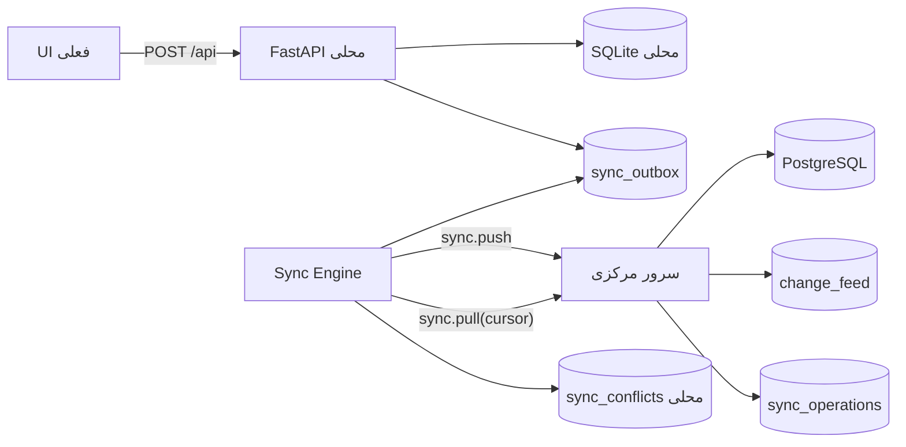

# طراحی همگام‌سازی آفلاین — White Rose Clinic (نسخهٔ Python)

> **فاز:** ۱ · **وضعیت:** پیش‌نویس برای تأیید مدیر · **الگو:** Offline-first با Outbox + Change Feed · **Developed by FoBa**
>
> هدف: کارکرد کامل ایستگاه دسکتاپ بدون اینترنت/قطع اتصال به سرور، با تضمین عدم گم‌شدن و عدم تکرار دادهٔ مالی و حل قطعی تعارض‌ها.

---

## ۱) اصول

1. **کلاینت همیشه کار می‌کند:** هر عملیات ابتدا در SQLite محلی اعمال می‌شود و سپس در `sync_outbox` ثبت می‌شود.
2. **سرور منبع حقیقت برای اعداد حساس:** شمارهٔ فاکتور، پورسانت، محاسبات نهایی، مجوزها و دادهٔ مرجع.
3. **Idempotency مطلق:** هر عملیات `op_id` یکتا دارد؛ ارسال دوباره اثر مضاعف ندارد.
4. **ترتیب علّی:** عملیات وابسته پس از ack والد ارسال می‌شوند (`depends_on`).
5. **تعارض پنهان ممنوع:** تعارض‌های حل‌نشدنی در صف باز و قابل مشاهدهٔ مدیر؛ «آخرین نوشتن بی‌صدا» برای دادهٔ مالی اعمال نمی‌شود.
6. **قابل بازرسی:** هر عملیات در `audit_log` و `sync_operations` قابل ردیابی است.
7. **بازیابی کامل:** دستگاه جدید با `bootstrap` کامل (pull از revision صفر) راه‌اندازی می‌شود.

---

## ۲) معماری مؤلفه‌ها



| مؤلفه | محل | نقش |
|---|---|---|
| `sync_outbox` | SQLite | صف پایدار عملیات محلی با ترتیب `op_seq` |
| Sync Engine | Desktop (پس‌زمینه) | دسته‌بندی، ارسال، retry، pull، اعمال تغییرات |
| `sync_operations` | PostgreSQL | dedupe و نتیجهٔ هر پاکت |
| `change_feed` | PostgreSQL | جریان تغییرات با `revision` یکنوا برای pull |
| `sync_conflicts` | هر دو | تعارض‌های باز و تصمیم‌ها |
| `devices` | PostgreSQL | ثبت و ابطال ایستگاه‌ها |

---

## ۳) چرخهٔ عمر یک عملیات

```text
[1] کاربر action را اجرا می‌کند
     └─ اعتبارسنجی محلی → نوشتن در SQLite → درج پاکت در outbox (pending)
[2] Sync Engine (رویدادی + دوره‌ای)
     └─ انتخاب N پاکت pending با رعایت depends_on → status=sending → sync.push
[3] سرور برای هر پاکت
     ├─ بررسی دستگاه/توکن/کاربر
     ├─ dedupe با op_id → اگر تکراری: همان result_json
     ├─ اعتبارسنجی دامنه (Pydantic + قواعد + ماشین وضعیت + row_version)
     ├─ اعمال در تراکنش + ثبت change_feed + Audit
     └─ نتیجه: applied | rejected(code) | conflict
[4] کلاینت نتیجه را اعمال می‌کند
     ├─ applied  → acked + به‌روزرسانی رکورد محلی (شمارهٔ رسمی، row_version)
     ├─ rejected → rejected + نمایش خطای فارسی (اصلاح و ارسال اصلاحی در صورت نیاز)
     └─ conflict → conflict + صف تعارض + اعلان مدیر
[5] pull
     └─ تغییرات بعد از cursor → upsert محلی (به‌جز رکوردهای دارای عملیات pending)
          → ذخیرهٔ cursor
```

**بازهٔ پیشنهادی:** push هر ۵ ثانیه در حالت آنلاین، pull هر ۳۰ ثانیه، و اجرای فوری پس از هر عملیات کاربر (debounce ۵۰۰ms). در حالت آفلاین، تلاش با backoff نمایی.

---

## ۴) پاکت عملیات (Operation Envelope)

| فیلد | نوع | قاعده |
|---|---|---|
| `op_id` | uuid | یکتا در کل سیستم (UUIDv7) |
| `device_id` | uuid | دستگاه ثبت‌شده |
| `device_seq` | int64 | یکنوا و بدون شکاف در هر دستگاه |
| `actor_user_id` | uuid | کاربر انجام‌دهنده (از نشست محلی) |
| `entity` | enum | `patients`, `doctors`, `operators`, `services`, `invoices`, `payments`, `expenses`, `other_income`, `commissions`, `settings` |
| `op_type` | enum | `create`, `update`, `delete`, `command` |
| `entity_id` | uuid | شناسهٔ رکورد (برای ایجاد، از پیش تولیدشده) |
| `base_row_version` | int64 \| null | نسخهٔ مبنای ویرایش (برای کشف تعارض) |
| `command` | string \| null | `issue`, `void`, `request_discount`, `approve_discount`, `commission.payable`, `commission.paid` |
| `payload` | json | فقط فیلدهای تغییریافته (برای update) |
| `occurred_at` | ISO-8601 | زمان وقوع در دستگاه (مشورتی) |
| `depends_on` | uuid \| null | `op_id` والد |
| `payload_hash` | sha256 | تشخیص دست‌کاری/تکرار متفاوت |

**حدود:** حداکثر ۲۰۰ پاکت یا ۲MB در هر `sync.push`.

---

## ۵) قواعد اعمال در سرور (به ترتیب)

1. **احراز دستگاه:** `device_token` معتبر و `is_active`؛ وگرنه `SYNC_REJECTED` با کد `DEVICE_REVOKED`.
2. **کاربر:** `actor_user_id` فعال؛ وگرنه `USER_INACTIVE` (پاکت در صف تعارض می‌ماند).
3. **Idempotency:** وجود `op_id` → پاسخ ذخیره‌شده؛ اگر `payload_hash` متفاوت بود → `CONFLICT` (`SAME_OP_DIFFERENT_PAYLOAD`).
4. **دسترسی:** همان ماتریس RBAC (اکشن معادل)؛ آفلاین مجوز را دور نمی‌زند.
5. **ترتیب:** `device_seq` باید بزرگ‌تر از آخرین `device_seq` اعمال‌شده باشد، مگر با `depends_on` صریح.
6. **نسخه:** برای `update`/`command` روی رکورد موجود، `base_row_version` باید برابر `row_version` فعلی باشد؛ وگرنه ورود به ماتریس تعارض.
7. **قاعدهٔ دامنه:** از همان use-case آنلاین استفاده می‌شود (بدون مسیر موازی) → یکسان بودن قواعد مالی و Audit.
8. **ثبت change_feed:** برای همهٔ تغییرات اعمال‌شده (شامل شمارهٔ رسمی فاکتور).

---

## ۶) ماتریس حل تعارض

| موجودیت/عملیات | سیاست | توضیح |
|---|---|---|
| `patients` (ویرایش فیلد) | **field-level LWW** با `row_version` | تغییر فیلدهای متفاوت ادغام می‌شود؛ تغییر هم‌زمان یک فیلد → برندهٔ `occurred_at` بزرگ‌تر + Audit |
| `doctors` / `operators` / `services` | **server-wins** | در آفلاین فقط‌خواندنی؛ تلاش نوشتن → `SYNC_REJECTED` |
| `settings`, `users` | **server-wins** | فقط admin آنلاین |
| `invoices` پیش‌نویس (ویرایش) | **version conflict** | اختلاف `row_version` → تعارض باز؛ مدیر انتخاب می‌کند (پیش‌نویس بدون اثر مالی) |
| `invoices.issue` | **server-authoritative** | قبلاً صادر شده → `INVALID_STATE`؛ شمارهٔ رسمی در نتیجه برمی‌گردد |
| `invoices.void` | **state conflict** | اگر فاکتور پس از نسخهٔ کلاینت پرداخت خورده باشد → تعارض باز (نیازمند تصمیم مدیر) |
| تخفیف (request/approve) | **state machine** | درخواست/تأیید تکراری → `INVALID_STATE`؛ تغییر هم‌زمان مبلغ → تعارض |
| `payments` (ایجاد) | **append-only** | پرداخت‌ها تجمعی‌اند؛ دو پرداخت هم‌زمان هر دو ثبت می‌شوند؛ سقف مانده طبق TD-09 |
| `expenses` / `other_income` | append + LWW برای ویرایش | حذف در آفلاین فقط نرم |
| `commissions` | **server-only** | کلاینت هرگز پورسانت نمی‌سازد؛ فقط pull |
| شمارهٔ فاکتور | **سرور** | شمارهٔ موقت همیشه با شمارهٔ رسمی جایگزین می‌شود |
| حذف (soft delete) | **tombstone + version** | حذف برنده، ولی رکورد قابل بازیابی |

**صف تعارض:** هر تعارض با `client_payload` و `server_snapshot` ذخیره می‌شود؛ UI مدیر (فاز بعد) امکان «اعمال نسخهٔ کلاینت»، «نگه‌داشتن نسخهٔ سرور» یا «ورود دستی» را می‌دهد. هر تصمیم در Audit ثبت می‌شود.

---

## ۷) شماره‌گذاری در آفلاین

- پیش‌نویس آفلاین: `invoice_no = ''` (مانند نسخهٔ فعلی تا صدور).
- صدور آفلاین: شمارهٔ **موقت** `TMP-<node_code>-<seq6>` در `invoice_no_provisional`؛ به کاربر با نشانهٔ «در انتظار شمارهٔ رسمی» نمایش داده می‌شود.
- پس از sync موفق: سرور شمارهٔ رسمی `PREFIX-YYYY-NNNNNN` را تخصیص می‌دهد؛ کلاینت آن را در `invoice_no` جایگزین و `server_revision` را ثبت می‌کند.
- چاپ سند پیش از دریافت شمارهٔ رسمی فقط به‌صورت «پیش‌نویس/غیررسمی» مجاز است (TD-13).
- شمارندهٔ محلی صرفاً برای یکتایی موقت است؛ هرگز مبنای شمارهٔ رسمی نیست.

---

## ۸) Pull و Bootstrap

- `sync.pull` با `cursor` (= `last_pull_revision` دستگاه) و `limit` (پیش‌فرض ۵۰۰ تغییر) → صفحه‌بندی با `has_more`.
- تغییرات به‌ترتیب `revision` اعمال می‌شوند؛ در صورت شکاف (compaction) دستگاه به **bootstrap کامل** هدایت می‌شود.
- **Bootstrap:** دریافت snapshot کامل (NDJSON یا فایل فشرده) + تنظیم `cursor` روی `max(revision)` + بازسازی ایندکس‌ها.
- تغییرات شامل `delete` (tombstone) است تا رکوردهای حذف‌شده در کلاینت هم ناپدید شوند.
- تغییرات ناشی از خود دستگاه (بر اساس `origin_device_id`) در pull نادیده گرفته می‌شوند (صرفه‌جویی + جلوگیری از رگرسیون).

---

## ۹) Retry، کارایی و امنیت

| موضوع | تصمیم |
|---|---|
| Backoff | ۱s, ۲s, ۴s, ۸s, ۱۶s, ۳۰s, ۶۰s, ۱۲۰s (سقف) + jitter ±۲۰٪ |
| حداکثر تلاش خودکار | ۱۰ بار؛ سپس `conflict` با علت `RETRY_EXHAUSTED` |
| ارسال دسته‌ای | حداکثر ۲۰۰ پاکت/۲MB؛ تفکیک خودکار در صورت عبور |
| ترتیب | صف بر اساس `op_seq`؛ عملیات با والد ack نشده ارسال نمی‌شود |
| قطع شبکه | خطای شبکه = `pending`؛ هیچ پاکتی حذف نمی‌شود |
| امنیت | TLS + device token + محدودیت نرخ per-device؛ ابطال دستگاه فوراً مؤثر |
| Replay | `op_id` یکتا + `payload_hash` + `device_seq` یکنوا |
| حریم خصوصی | payload همگام‌سازی شامل هش/توکن نیست؛ فقط فیلدهای دامنه |
| مانیتورینگ | `sync.status` + هشدار صف > ۵۰۰ یا تعارض باز > ۰ برای مدیر |

---

## ۱۰) سناریوهای تست اجباری (فاز پیاده‌سازی)

1. ایجاد بیمار آفلاین → sync → وجود در سرور با همان `id`؛ تکرار `push` → `duplicate:true`.
2. ایجاد فاکتور آفلاین با اقلام → صدور آفلاین → sync → دریافت شمارهٔ رسمی و پورسانت‌ها.
3. دو دستگاه: ویرایش هم‌زمان بیمار (فیلدهای متفاوت) → ادغام؛ (فیلد یکسان) → LWW + Audit.
4. ویرایش پیش‌نویس فاکتور در دو دستگاه → تعارض نسخه و تصمیم مدیر.
5. پرداخت آفلاین روی فاکتورِ ابطال‌شده در سرور → `rejected: INVALID_STATE` + صف تعارض.
6. ابطال آفلاین فاکتورِ دارای پرداخت جدید در سرور → تعارض و تصمیم مدیر.
7. قطع شبکه در میانهٔ push → هیچ پاکتی گم نمی‌شود؛ پس از اتصال ادامه می‌یابد.
8. ابطال دستگاه → `push` با `DEVICE_REVOKED` و مسدودسازی pull.
9. Bootstrap دستگاه جدید → سازگاری کامل شمارش‌ها با سرور.
10. یکپارچگی پس از sync: `sum(payments) == invoices.paid_toman` و `sum(discount_alloc) == discount_toman`.

---

## ۱۱) محدودیت‌ها و تصمیم‌های باز

- دسکتاپ آفلاین، کاربران/تنظیمات جدید نمی‌سازد (server-wins).
- صدور فاکتور آفلاین نیازمند تأیید سیاست کاری «شمارهٔ موقت» است (TD-13).
- چند دستگاه هم‌زمان روی یک ایستگاه (پروفایل مشترک ویندوز) پشتیبانی نمی‌شود؛ هر نصب = یک `device`.
- تغییر ساعت سیستم اثر ندارد: زمان سرور مرجع `received_at` است؛ `occurred_at` فقط برای حل تعارض و گزارش «زمان وقوع» استفاده می‌شود.

---

## ۱۲) شماره‌گذاری — تصمیم قطعی TDR-013

1. **UUID ثابت:** فاکتور حتی پیش از اتصال، `id` (UUIDv7) نهایی و تغییرناپذیر دارد؛ Retry هرگز فاکتور دوم نمی‌سازد.
2. **شمارهٔ موقت:** `TMP-<node_code>-<local_seq6>` (مثال `TMP-N01-000123`) که `node_code` از `devices.node_code` و `local_seq` از Sequence محلی SQLite (`sequences` کلید `local_invoice_<year>`) می‌آید.
3. **شمارهٔ رسمی:** فقط سرور و در **یک تراکنش** با `SELECT … FOR UPDATE` روی `sequences` تخصیص می‌دهد: `PREFIX-YYYY-NNNNNN`.
4. **یکتایی سراسری:** `invoices.invoice_no` یکتای جزئی (`WHERE invoice_no <> '' AND is_deleted = false`)؛ شمارهٔ موقت در ستون جدا `invoice_no_provisional` نگه داشته می‌شود.
5. **تاریخچه:** جدول `invoice_number_history` (id, invoice_id, number, number_type `provisional|official`, assigned_at, assigned_by_device, revision) — هم شمارهٔ موقت و هم رسمی حفظ می‌شوند.
6. **وضعیت نهایی:** فاکتور تا دریافت شمارهٔ رسمی `status` عملیاتی دارد ولی فیلد `numbering_state = 'provisional'` است؛ UI/چاپ باید «پیش‌نویس/غیررسمی» را نشان دهد و گزارش‌های رسمی فقط فاکتورهای `official` را بشمارند.
7. **Retry/Idempotency:** `sync.push` با همان `op_id` → `duplicate:true` و همان `result_json` (شامل شمارهٔ رسمی)؛ هیچ شمارهٔ جدیدی مصرف نمی‌شود.
8. **تعارض:** اگر دو دستگاه برای یک فاکتور UUID یکسان عمل کنند، یکی `applied` و دیگری `duplicate` می‌شود؛ در تناقض محتوایی، `CONFLICT` (TDR-006).

---

## ۱۳) همگام‌سازی اصلاح فاکتور و اعتبار (قطعی)

| عملیات | نوع پاکت | قاعده |
|---|---|---|
| ایجاد اصلاح | `command: invoice.amend.draft` | پیش‌نویس اصلاح آفلاین مجاز؛ در سرور با `base_row_version` فاکتور بررسی می‌شود |
| صدور اصلاح | `command: invoice.amend.issue` | فقط سرور اثر مالی می‌دهد؛ محاسبه و پورسانت در سرور |
| ابطال اصلاح | `command: invoice.amend.void` | علت اجباری؛ اگر اصلاح پس از نسخهٔ کلاینت صادر شده → `CONFLICT` |
| اعتبار (افزایش) | `command: credit.overpayment` | فقط در نتیجهٔ پرداخت؛ هرگز پاکت مستقل «افزایش اعتبار» بدون مرجع پرداخت پذیرفته نمی‌شود |
| استفادهٔ اعتبار | `command: credit.apply` | اتمی با پرداخت؛ idempotency کلیدی `credituse:<payment_id>` |
| اصلاح دستی اعتبار | `command: credit.adjust` | فقط admin آنلاین؛ در آفلاین رد می‌شود (`SYNC_REJECTED`) |

**قاعدهٔ طلایی:** تعارض مالی (اصلاح/ابطال/اعتبار) **هرگز** ادغام خودکار نمی‌شود؛ به `sync_conflicts` می‌رود و تا تصمیم مدیر، عملیات‌های بعدی همان رکورد در صف می‌مانند.


