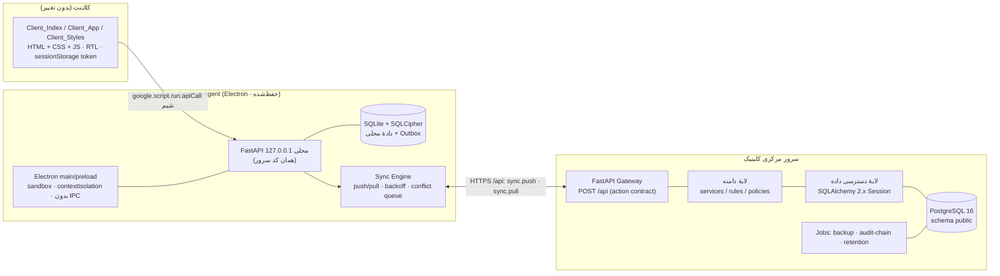

# معماری سیستم — White Rose Clinic (نسخهٔ Python)

> **فاز:** ۱ (طراحی معماری و دامنه) · **وضعیت:** پیش‌نویس برای تأیید مدیر · **نسخهٔ سند:** 1.0
> **تاریخ:** ۲۰۲۶-۱۱-۲۳ · **پروژه مرجع:** `white-rose-clinic` v0.4.3 (Apps Script + Google Sheets) · **Developed by FoBa**
>
> **محدودهٔ این فاز:** فقط مستندسازی. هیچ کد بک‌اند، نصب PostgreSQL، اتصال واقعی، انتقال داده، Push یا Deploy انجام نشده و پروژهٔ مرجع دست‌نخورده است.

---

## ۱) هدف سند

این سند معماری کلان نسخهٔ Python سامانهٔ مدیریت کلینیک «رز سفید» را تعریف می‌کند: اجزای اجرایی، مرزهای مسئولیت، جریان داده، مدل استقرار و قواعد لایه‌بندی. جزئیات دامنه، پایگاه داده، API، امنیت، همگام‌سازی و نگاشت مهاجرت در اسناد جداگانه آمده‌اند:

| سند | موضوع |
|---|---|
| [`DOMAIN_MODEL.md`](./DOMAIN_MODEL.md) | ۱۸ ماژول دامنه، قواعد تجاری، مجوزها |
| [`DATABASE_DESIGN.md`](./DATABASE_DESIGN.md) | ERD، کلیدها، ایندکس‌ها، مبالغ Decimal، متادیتای همگام‌سازی |
| [`API_DESIGN.md`](./API_DESIGN.md) | قرارداد واحد سازگار با UI فعلی + اکشن‌های جدید |
| [`SECURITY_DESIGN.md`](./SECURITY_DESIGN.md) | احراز هویت، نشست، RBAC، Audit، رمزنگاری |
| [`OFFLINE_SYNC_DESIGN.md`](./OFFLINE_SYNC_DESIGN.md) | صف آفلاین، حل تعارض، نسخه‌بندی تغییرات |
| [`MIGRATION_MAPPING.md`](./MIGRATION_MAPPING.md) | نگاشت شیت/اکشن/قاعده از نسخهٔ فعلی به نسخهٔ جدید |
| [`TECHNICAL_DECISIONS.md`](./TECHNICAL_DECISIONS.md) | تصمیم‌های فنی (TDR) و موارد نیازمند تأیید مدیر |

**منابع مطالعه‌شده (مبنای طراحی):** `docs/requirements.md`، `docs/data-model.md`، `docs/architecture.md`، `docs/permissions.md`، `docs/design-system.md`، `docs/roadmap.md`، `docs/executive-defaults.md`، `docs/deployment.md`، `AUDIT-v0.4.3.md` و کدهای `src/Server_00..15.gs`، `src/Client_*.html`، `desktop/main.js`، `desktop/server.js`، `desktop/README.md`.

---

## ۲) اهداف و غیراهداف

### اهداف
1. **موتور دامنهٔ مستقل** با Python/FastAPI به‌عنوان منبع واحد حقیقت قواعد مالی و مجوزها.
2. **PostgreSQL مرکزی** برای استقرار چندکاربره در کلینیک (شبکهٔ محلی) با پشتیبان‌گیری و بازیابی واقعی.
3. **Desktop Agent آفلاین‌اول** با SQLite محلی، پایدار و رمزنگاری‌شده؛ کارکرد کامل بدون اینترنت.
4. **حفظ رابط فعلی** HTML/CSS/JavaScript و حفظ Electron در مرحلهٔ اول (بدون بازنویسی UI).
5. **نسخهٔ کاملاً خالی**؛ بدون دادهٔ نمونه، بدون Seed عملیاتی، بدون انتقال داده از Google Sheets.
6. رفع نواقص ساختاری شناخته‌شدهٔ ممیزی ۰.۴.۳ (C-01، C-02، H-01..H-06) در سطح **طراحی**.

### غیراهداف (این فاز)
- پیاده‌سازی کد، اجرای مهاجرت Alembic، نصب PostgreSQL، ساخت فایل نصبی، تولید PDF، انتشار.
- انتقال داده‌های نسخهٔ فعلی (طبق درخواست کارفرما فقط ساختار مرجع است).
- تغییر در رمزها، تنظیمات، مخزن یا محیط پروژهٔ مرجع.

---

## ۳) نمای کلی معماری



### سه بستر اجرا، یک قرارداد
همان الگوی موفق نسخهٔ فعلی حفظ می‌شود: رابط کاربری فقط یک تابع می‌شناسد —

```
apiCall(action: string, payload: object, token: string)
  → { ok: true, data: ... } | { ok: false, error: { code, message, details? } }
```

این قرارداد در هر دو بستر پیاده می‌شود:
- **سرور مرکزی:** `POST /api` روی FastAPI (JSON).
- **Desktop:** همان endpoint روی سرور محلی ۱۲۷.۰.۰.۱؛ شیم `google.script.run` در `desktop/server.js` معادل فعلی باقی می‌ماند.

نتیجه: UI فعلی (۱۲۸KB جاوااسکریپت) **بدون بازنویسی** روی موتور Python کار می‌کند؛ فقط شیم انتقال (fetch → localhost) و لایهٔ اجرای اکشن عوض می‌شود.

---

## ۴) اجزای سیستم و مرزهای مسئولیت

| جزء | مسئولیت | مسئولیت ندارد |
|---|---|---|
| **UI (HTML/CSS/JS فعلی)** | نمایش، اعتبارسنجی سبک ورودی، نگه‌داری توکن در `sessionStorage` | محاسبهٔ مالی، تصمیم مجوز، ذخیرهٔ داده |
| **API Gateway (FastAPI)** | مسیر‌دهی اکشن، احراز هویت نشست، همگام‌کردن پاسخ با قرارداد `{ok,...}`، نرخ‌محدودسازی | منطق دامنه، دسترسی مستقیم به DB |
| **Application/Domain Services** | قواعد تجاری، ماشین وضعیت، محاسبات `Decimal`، سیاست مجوز در سطح عملیات | I/O مستقیم، SQL خام |
| **Repositories (SQLAlchemy 2.x)** | کوئری، قفل ردیف، تراکنش، فیلتر نقش‌محور در SQL | قواعد تجاری |
| **Sync Engine (Desktop)** | صف عملیات، push/pull، backoff، صف تعارض، bootstrap کامل | محاسبهٔ مجدد قواعد سروری |
| **Jobs** | پشتیبان‌گیری زمان‌بندی‌شده، زنجیرهٔ هش Audit، نگهداشت داده، بررسی سلامت | عملیات کاربر |
| **Electron Shell** | پنجره، سخت‌سازی، بارگذاری UI از سرور محلی | منطق کسب‌وکار |

**قاعدهٔ لایه‌بندی (غیرقابل نقض):** `api → application → domain` و `infrastructure` فقط توسط `application` مصرف می‌شود. هیچ روتر FastAPI مستقیماً `Session` نمی‌سازد و هیچ سرویس دامنه‌ای SQL نمی‌نویسد. (معادل قاعدهٔ موفق نسخهٔ فعلی: `Api → Services → SheetRepo`.)

---

## ۵) پشتهٔ فناوری (مطابق محیط فعلی)

| لایه | انتخاب | نسخهٔ تأییدشده در `.venv` |
|---|---|---|
| زبان | Python | **3.13.17** (64-bit) |
| وب فریم‌ورک | FastAPI | 0.165.0 |
| ASGI Server | Uvicorn (+httptools/watchfiles) | 0.54.0 |
| ORM | SQLAlchemy 2.x (Sync Session) | 2.1.9 |
| مهاجرت اسکیما | Alembic | 1.20.1 |
| اعتبارسنجی/تنظیمات | Pydantic v2 + pydantic-settings | 2.14.4 / 2.16.3 |
| DB سرور | PostgreSQL | 16.x (نصب نشده — این فاز ممنوع) |
| DB دسکتاپ | SQLite (+SQLCipher) | 3.50.4 موجود |
| کلاینت | HTML/CSS/JS فعلی (بدون فریم‌ورک) | بدون تغییر |
| پوستهٔ دسکتاپ | Electron (فعلی) | بدون تغییر در فاز ۱ |
| تست | pytest + httpx + pytest-asyncio | **نصب‌نشده** (نیازمند نصب در فاز پیاده‌سازی) |

> هیچ پکیج جدیدی در این فاز نصب نشده است. فهرست نصب‌های لازم در `TECHNICAL_DECISIONS.md` (بخش پیش‌نیازها) آمده است.

---

## ۶) ساختار پوشهٔ پیشنهادی (فاز ۲ به بعد)

```text
white-rose-clinic-migration/
├─ .venv/                          # حفظ‌شده (خارج از Git)
├─ docs/architecture/              # همین اسناد
├─ backend/
│  ├─ pyproject.toml               # وابستگی‌ها + ابزارها (ruff/pytest)
│  ├─ alembic.ini
│  ├─ migrations/versions/         # اسکریپت‌های Alembic
│  └─ app/
│     ├─ main.py                   # ساخت اپ، مسیرها، lifespan
│     ├─ core/                     # settings, security, errors, logging, clock
│     ├─ api/                      # gateway: /api (action router) + /healthz
│     ├─ domain/                   # موجودیت‌ها، قواعد، ماشین وضعیت، مبالغ
│     ├─ application/              # سرویس‌های کاربردی (use-cases) + مجوزها
│     ├─ infrastructure/
│     │  ├─ db/                    # engine/session, models, repositories
│     │  ├─ sync/                  # outbox, change_feed, conflict resolver
│     │  └─ backup/                # export/import، checksum، رمزنگاری
│     └─ webui/                    # سرو کردن همان فایل‌های HTML فعلی
├─ desktop/                        # Electron فعلی (حفظ‌شده) + راه‌انداز سرور محلی
├─ frontend/                       # کپی کنترل‌شدهٔ Client_*.html از پروژهٔ مرجع (بدون تغییر منطق)
└─ docs/
```

**نکته:** UI فعلی داخل `src/Client_*.html` پروژهٔ مرجع است. در فاز پیاده‌سازی، همان فایل‌ها **کپی** می‌شوند (پروژهٔ مرجع تغییر نمی‌کند) و فقط باگ‌های UI ذکرشده در ممیزی (M-02، M-07) به‌صورت افزایشی اصلاح می‌شوند.

---

## ۷) جریان درخواست

### حالت آنلاین (سرور مرکزی)
```text
Browser → POST /api {action,payload,token}
  → Gateway: rate-limit → resolve session (Token → user)
  → Router: action → use-case → permission assert
  → use-case: validation (Pydantic) → domain rules (Decimal) → repository (Session tx)
  → audit append (در همان تراکنش برای عملیات حساس)
  → {ok:true,data} | {ok:false,error{code,message}}
```

### حالت آفلاین (Desktop Agent)
```text
Browser → POST http://127.0.0.1:<random>/api
  → همان Gateway و همان use-case، ولی Session روی SQLite
  → اگر عملیات «مالکیت سرور» دارد (شمارهٔ فاکتور، پورسانت نهایی):
       ثبت در outbox + پاسخ با وضعیت "pending_sync"
  → Sync Engine: push دوره‌ای/رویدادی → سرور مرکزی → ack/conflict
  → pull تغییرات بعدی (change_feed) → به‌روزرسانی SQLite محلی
```

**قاعدهٔ طلایی:** هر اکشن یک **تراکنش** است؛ یا کامل اعمال می‌شود یا هیچ. عملیات حساس (صدور فاکتور، پرداخت، ابطال، تخفیف، حذف کلی، بازیابی) قفل ردیف/دنباله می‌گیرند.

---

## ۸) مدل استقرار

### توپولوژی هدف (کلینیک تک‌شعبه)
```text
[کلاینت‌های دسکتاپ]  ──HTTPS (LAN)──►  [سرور کلینیک: FastAPI + PostgreSQL]
   4..10 ایستگاه                        127.0.0.1:8000 پشت Reverse Proxy/TLS
   SQLite محلی                            پشتیبان روزانه → دیسک جداگانه
   Outbox + Sync                          (اختیاری) دسترسی خارج از شبکه: VPN
```

| موضوع | تصمیم طراحی |
|---|---|
| اتصال کاربران | فقط `127.0.0.1` برای Desktop؛ سرور روی شبکهٔ محلی با TLS (گواهی داخلی) |
| Reverse Proxy | Nginx/Caddy در تولید؛ Uvicorn بدون reverse proxy فقط در توسعه |
| پورت‌ها | ۸۰۰۰ (سرور)، پورت تصادفی برای سرور محلی دسکتاپ (رفتار فعلی حفظ می‌شود) |
| مقیاس | ۳..۱۵ کاربر هم‌زمان؛ pool اتصال PG: ۵ + ۵ overflow |
| چند شعبه | خارج از دامنهٔ فاز ۱ (کلید `branch_id` رزرو می‌شود — TD-12) |

### Desktop
- سرور محلی فقط روی `127.0.0.1` و **پورت تصادفی** (مانند `desktop/server.js` فعلی).
- SQLite در `%LOCALAPPDATA%\WhiteRoseClinic\data\wrc.db` با **SQLCipher**؛ کلید با Windows DPAPI محافظت می‌شود.
- Electron مراحل سخت‌سازی فعلی را حفظ می‌کند: `contextIsolation`, `sandbox`, `nodeIntegration=false`, بدون IPC، مسدودسازی ناوبری، رد مجوزها.

---

## ۹) ذخیره‌سازی و داده

| موضوع | سرور مرکزی | Desktop |
|---|---|---|
| موتور | PostgreSQL 16 | SQLite 3.50 + SQLCipher |
| اسکیما | همان مدل SQLAlchemy (Alembic) | همان مدل، با انواع سازگار (UUID→BLOB/CHAR, NUMERIC→NUMERIC, JSONB→JSON) |
| مبالغ | `NUMERIC(18,1)` تومان | همان |
| زمان | `TIMESTAMPTZ` (UTC ذخیره، نمایش `Asia/Tehran`) | `TEXT` ISO-8601 UTC |
| متادیتای همگام | `row_version`, `revision`, `origin_node_id`, `sync_state` | `sync_state`, `server_revision`, `outbox` |
| پشتیبان | `pg_dump` روزانه + checksum + رمزنگاری | export JSON امن + کپی فایل رمزنگاری‌شده |

جزئیات کامل در `DATABASE_DESIGN.md`.

---

## ۱۰) پیکربندی و اسرار

- تنظیمات با `pydantic-settings` از `.env` (خارج از Git) و متغیرهای محیطی: `WRC_DATABASE_URL`, `WRC_SECRET_KEY`, `WRC_SESSION_TTL`, `WRC_ALLOWED_ORIGINS`, `WRC_TLS_*`.
- هیچ رمز/کلیدی در کد یا مستندات ذخیره نمی‌شود؛ رمز پیش‌فرض نسخهٔ دسکتاپ (`Wrc#Desktop#1`) **حذف** می‌شود `[AUDIT M-03]`.
- تنظیمات کسب‌وکار (مالیات، پیشوند فاکتور، …) در جدول `settings` با کاتالوگ اعتبارسنجی‌شده و راهنمای فارسی (سازگار با `SettingsSvc.CATALOG` فعلی).
- تفکیک نقش‌های DB: `wrc_app` (DML)، `wrc_migrator` (DDL)، `wrc_backup` (`SELECT` فقط).

---

## ۱۱) مدل خطا، لاگ و پایش

### مدل خطا (سازگار با UI فعلی)
```json
{ "ok": false, "error": { "code": "INVALID_STATE", "message": "فاکتور قبلاً صادر شده است.", "details": null } }
```
کدهای پایه: `VALIDATION`, `UNAUTHORIZED`, `FORBIDDEN`, `NOT_FOUND`, `DUPLICATE`, `INVALID_STATE`, `CONFLICT`, `LOCK_TIMEOUT`, `AUTH_FAILED`, `AUTH_LOCKED`, `RATE_LIMITED`, `SYNC_REJECTED`, `INTERNAL`.

- پیام فارسی برای کاربر؛ جزئیات فنی **هرگز** در پاسخ تولیدی افشا نمی‌شود `[AUDIT M-08]`.
- هر خطای سرور با `request_id` در لاگ ثبت می‌شود و همان `request_id` در پاسخ برمی‌گردد.

### لاگ و پایش
- لاگ ساختاریافته JSON (stdout + فایل چرخشی)، با `request_id`, `user_id`, `action`, `duration_ms`, `result`.
- لاگ ممیزی در **جدول** `audit_log` (append-only، زنجیرهٔ هش روزانه) — نه فایل.
- Health: `GET /healthz` (زنده)، `GET /readyz` (اتصال DB + Alembic head)، `GET /api/meta/version`.
- Desktop: لاگ محلی چرخشی + شاخص وضعیت همگام‌سازی (آخرین push/pull، صف، تعارض‌ها).
- متریک‌های سبک (اختیاری فاز بعد): تعداد درخواست، تأخیر p95، طول صف همگام‌سازی.

---

## ۱۲) مهاجرت اسکیما و نسخه‌بندی

- **Alembic** منبع واحد DDL؛ `alembic upgrade head` در استارتاپ **اختیاری و کنترل‌شده** (در تولید فقط با تأیید مدیر/استقرار).
- نسخهٔ اسکیما در `meta.schema_version` و در فایل پشتیبان ثبت می‌شود؛ بازیابی فقط برای نسخه‌های سازگار.
- Desktop نیز همان زنجیرهٔ Alembic را روی SQLite اجرا می‌کند (با محدودیت‌های `batch_alter_table`).
- سیاست سازگاری: تغییرات فقط افزایشی؛ حذف ستون فقط پس از دو نسخه و با مهاجرت داده.

---

## ۱۳) راهبرد تست و کیفیت (فاز پیاده‌سازی)

| سطح | ابزار | دامنه |
|---|---|---|
| واحد دامنه | pytest | محاسبهٔ فاکتور/تخفیف/مالیات/پورسانت، گرد کردن ریال، ماشین وضعیت |
| قرارداد API | pytest + httpx (TestClient) | همهٔ اکشن‌ها، پاکت پاسخ، کدهای خطا |
| مجوز | pytest (پارامتری) | ماتریس کامل نقش×اکشن (شامل نقش پزشک محدود) |
| یکپارچگی DB | pytest + PostgreSQL موقت | یکتایی شماره فاکتور، تراکنش، قفل، حذف نرم |
| همگام‌سازی | pytest + SQLite | push/pull، idempotency، تعارض، backoff |
| UI | self-check سبک (پورت `tools/preview/self-check.js`) | رندر، مسیرها، عدم JSON خام در UI |
| دود (Smoke) | اسکریپت PowerShell | بوت سرور، `/healthz`, ورود، فاکتور نمونه در DB موقت |

**حداقل کیفیت برای Merge:** تست‌های واحد + قرارداد سبز، `ruff` بدون خطا، `mypy` روی لایهٔ دامنه (اختیاری فاز ۲).

---

## ۱۴) فازبندی پیشنهادی (پس از تأیید این اسناد)

| فاز | خروجی | دروازه |
|---|---|---|
| ۲ | اسکلت پروژه، settings، خطاها، Alembic، `/healthz`، UI سرو‌شده | بوت بدون خطا + تست دود |
| ۳ | Auth/Users + RBAC + Audit + SQLite محلی | تست ماتریس مجوز |
| ۴ | پایه‌ها (بیمار/پزشک/اپراتور/خدمت) + تنظیمات | CRUD + تست |
| ۵ | فاکتور/تخفیف/مالیات/پرداخت/پورسانت | ۴۳+ تست دامنهٔ معادل نسخهٔ فعلی |
| ۶ | گزارش‌ها (با اصلاح H-01) | تطابق اعداد با فاکتورها |
| ۷ | Sync Engine + Desktop packaging | سناریوهای آفلاین/تعارض |
| ۸ | Backup/Restore + استقرار PostgreSQL | تست بازیابی کامل |

---

## ۱۵) ریسک‌ها و محدودیت‌ها

| ریسک | اثر | کاهش |
|---|---|---|
| حفظ UI قدیمی با موتور جدید | ناسازگاری پاکت پاسخ/نام فیلدها | تست قرارداد اکشن‌به‌اکشن + لایهٔ آداپتور |
| دو موتور DB (PG/SQLite) | تفاوت انواع/رفتار قفل | تست یکپارچگی روی هر دو + Alembic مشترک |
| محاسبهٔ پول با float | خطای ریالی | `Decimal` اجباری + تست گرد کردن + `NUMERIC` |
| شمارهٔ فاکتور در حالت آفلاین | شمارهٔ موقت/تکراری | شمارهٔ موقت با نشانه + تخصیص نهایی سمت سرور (TD-13) |
| حجم کد UI فعلی | دشواری تغییر | عدم بازنویسی؛ فقط شیم انتقال و رفع باگ‌های ممیزی |
| نبود تست‌های API در نسخهٔ فعلی `[AUDIT H-05]` | رگرسیون | تست قرارداد از فاز ۳ اجباری |

---

## ۱۶) خروجی این فاز

- ۸ سند در `docs/architecture/` (همین پوشه).
- **هیچ** کد، پکیج، اتصال، داده یا تغییری در پروژهٔ مرجع ایجاد نشده است.
- موارد نیازمند تصمیم مدیر در `TECHNICAL_DECISIONS.md` (بخش «موارد باز») فهرست شده‌اند.

---

## ۱۷) وضعیت پیاده‌سازی فاز ۲ (نسخهٔ ۰.۵.۰)

| جزء | مسیر | وضعیت |
|---|---|---|
| اپ FastAPI | `backend/app/main.py` | ✅ `create_app()` + lifespan + middleware `request_id` |
| Health | `GET /healthz` (status, application, version, environment) + `GET /readyz` | ✅ |
| قرارداد API | `POST /api` با `{action,payload,token}` و پاکت `{ok,data|error}` | ✅ (`system.ping`, `system.bootstrapStatus` فعال؛ بقیه `ACTION_NOT_IMPLEMENTED`) |
| متادیتا | `GET /api/meta/version` + `GET /desktop/info` | ✅ |
| رابط فعلی | `GET /` با رندر includeهای `Client_*` + شیم `google.script.run` | ✅ (فایل‌ها بدون تغییر از مرجع کپی شده‌اند) |
| تنظیمات | `backend/app/core/config.py` (Pydantic Settings، ۱۰ کلید خواسته‌شده) | ✅ |
| خطاها | `backend/app/core/exceptions.py` + handler سراسری بدون Stack Trace | ✅ |
| لاگ | `backend/app/core/logging.py` (JSON + request_id) | ✅ |
| امنیت | `security.py` (توکن نشست/hash/Argon2id با fallback)، `permissions.py` (RBAC)، `dpapi.py` | ✅ |
| DB | `database/base.py` (mixins/UUIDv7)، `database/session.py` (Sync + PRAGMA) | ✅ |
| مدل‌ها | `database/models/*` (۲۸ جدول شامل amendment/credit/numbering) | ✅ |
| Alembic | `backend/alembic.ini` + `backend/migrations/versions/0001_initial_schema.py` | ✅ |
| تست | `backend/tests/*` (startup/health/config/db/migration/api/security/jalali/dpapi) | ✅ |

**قاعده:** UI هیچ بازطراحی نشده؛ فقط سرو می‌شود. مسیرهای `#dashboard`, `#invoices`, `#customers`, `#commissions`, `#expenses`, `#revenue`, `#reports`, `#doctors`, `#operators`, `#services`, `#commissionRules`, `#users`, `#settings` همه در فایل UI باقی هستند.

---

## ۱۸) ماژول‌های افزوده‌شده در فاز ۲

```text
backend/app/
├─ api/health.py        # /healthz, /readyz, /api/meta/version, /desktop/info
├─ api/router.py        # POST /api (action gateway) + registry اکشن‌ها
├─ core/config.py       # Settings (Pydantic Settings)
├─ core/exceptions.py   # WrcError + پاکت خطا
├─ core/logging.py      # JSON logging + request_id
├─ core/security.py     # session token, hash, Argon2id/PBKDF2
├─ core/permissions.py  # RBAC (admin/operator/doctor + amend/credit)
├─ core/dpapi.py        # Windows DPAPI با ctypes
├─ core/jalali.py       # الگوریتم جلالی داخلی (TDR-010)
├─ database/base.py     # Base + mixins + UUIDv7
├─ database/session.py  # engine/sessionmaker + session_scope
├─ database/models/     # system, identity, base_data, invoicing, finance, sync
├─ webui/renderer.py    # سرو Client_*.html با include resolver
├─ schemas/             # پاکت API و مدل‌های ورودی
├─ services/            # use-caseها (فاز ۳+)
└─ modules/             # ماژول‌های دامنه (فاز ۳+)
```

---

## ۱۹) نسخه و مسیر اجرا

- **نسخه:** `0.5.0` (فایل `VERSION`، `APP_VERSION`، `CHANGELOG.md`)
- **اجرا (توسعه):** `python -m uvicorn app.main:app --app-dir backend --reload`
- **مایگریشن:** `alembic -c backend/alembic.ini upgrade head`
- **تست:** `python -m pytest backend/tests -q`
- **DB توسعه:** SQLite (`sqlite+pysqlite:///./var/wrc-dev.db`) — PostgreSQL فقط هدف پیکربندی (نصب عملیاتی ممنوع تا اجازه).
- **حداقل رمز/داده:** هیچ حساب مدیر، Seed یا دادهٔ نمونه‌ای ساخته نمی‌شود.


